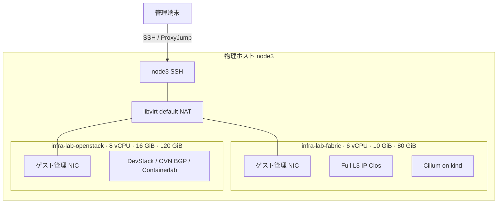
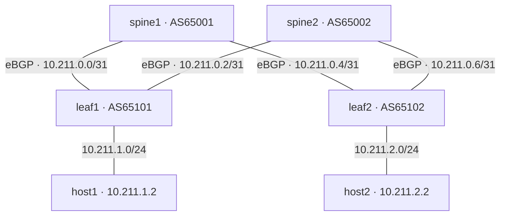
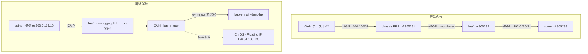
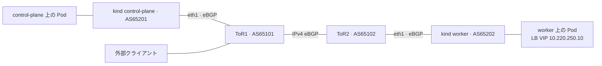

# Infra Lab

node3 上の検証専用 Linux VM で、Containerlab を使って IPv4 BGP を検証する。

| ディレクトリ | 検証内容 |
| --- | --- |
| [common](common/) | Linux VM の前提、Docker、Containerlab、共通 FRR 設定 |
| [Full L3 IP Clos](full-l3-ip-clos/) | 2 spine / 2 leaf の eBGP、ECMP、リンク障害時の収束と疎通 |
| [OpenStack OVN BGP Service Plugin](openstack-ovn-bgp-service-plugin/) | Neutron の OVN BGP Service Plugin と外部ルーター間の経路広告・撤回 |
| [Kubernetes Cilium Full L3 BGP on the Host](k8s-cilium-full-l3-bgp-on-the-host/) | ToR との host BGP、native routing、Pod CIDR と LoadBalancer VIP の広告 |

[共通セットアップ](common/README.md)を実行してから、各ラボの README に従う。各ラボの管理ネットワークとデータリンクは固有の名前とアドレスを使う。データリンクは検証専用 VM 内に閉じる。

## 作業レポート

node3 に libvirt の検証専用 VM を2台作成し、Containerlab で3つの IPv4 BGP ラボを起動した。以下は構築時に node3 で実行した検証の記録。

| ラボ | 検証結果 |
| --- | --- |
| Full L3 IP Clos | **合格**。4本の eBGP セッションと両 leaf の2経路 ECMP を確認。leaf1–spine1 断で両 leaf が spine2 に収束し、復旧後は2経路に戻った。各段階でホスト間の双方向 ping に成功。 |
| OpenStack OVN BGP Service Plugin | **経路交換は合格、疎通は未達**。Neutron の組み込みプラグインで Floating IP `198.51.100.100/32` を広告し、chassis のテーブル 42 と spine の BGP RIB・Linux FIB で確認。Floating IP の削除・再作成で撤回と再広告を確認。 |
| Kubernetes Cilium Full L3 BGP on the Host | **合格**。各 kind ノードの Pod CIDR と worker の LoadBalancer VIP を ToR で確認。ノード間と外部クライアントからの Pod 疎通、外部クライアントから VIP への HTTP、worker ピア停止時の経路撤回と復旧に成功。 |

### 物理ホストと VM の配置

管理端末は node3 を SSH 踏み台にして、既存の libvirt `default` NAT に接続したゲストへ入る。以下の実線は管理接続を示す。各ラボのデータリンクはゲスト内の仮想リンクで構成する。

両 VM の稼働中に、node3 の利用可能メモリは **6.3 GiB**、スワップ入出力カウンターはどちらも **0** だった。既存の CAPI VM は計測時に停止していた。作成・起動時のメモリ確認と再起動手順は [共通セットアップ](common/README.md) を参照。

### 論理構成 — Full L3 IP Clos

各 leaf が直結するホスト用プレフィックスを2台の spine に広告する。通常時は対向 leaf への2経路を ECMP で使う。

### 論理構成 — OpenStack OVN BGP

上段は確認済みの経路広告。下段は spine から送った ICMP の経路で、CirrOS への転送が未達。経路広告の確認には `verify.sh advertised` と `verify.sh withdrawn`、疎通の再現には `verify.sh reachable` を使う。

### 論理構成 — Cilium Full L3 BGP

各 kind ノードが Pod CIDR を隣接 ToR に広告する。worker は LoadBalancer VIP も広告する。Pod 間の通信はノードの `eth1` を通る native routing で、外部クライアントは ToR1 経由で Pod と VIP に到達する。

