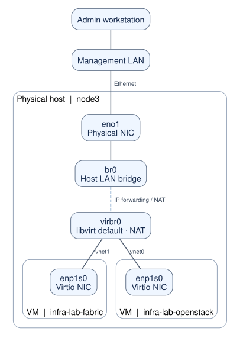

# 共通セットアップ

Containerlab と Docker は node3 上の検証専用 VM で動かす。Docker によるブリッジとファイアウォールの変更はゲスト内に閉じる。

| libvirt VM | 用途 | OS | vCPU | RAM | ディスク |
| --- | --- | --- | --- | --- | --- |
| `infra-lab-fabric` | CLOS と Cilium | Ubuntu 24.04 amd64 | 6 | 10 GiB | 80 GiB |
| `infra-lab-openstack` | OpenStack | Ubuntu 26.04 amd64 | 8 | 16 GiB | 120 GiB |

## 物理ホストと VM の配置

管理端末は node3 を SSH 踏み台にして、libvirt の管理ネットワークに接続したゲストへ入る。この図は管理 LAN から各 VM までの接続と配置を示す。



[図のソース](network.dot)

図中の `vnet0`、`vnet1` は実機で採取した名前。起動順によって変わる。

## node3 の VM 管理

`vm.sh` は既存の libvirt `default` NAT を使い、指定したクラウドイメージを独立した qcow2 ディスクにコピーする。ゲストの管理 NIC は NAT 経由で APT、Git、コンテナレジストリにアクセスする。ラボのデータポートは各トポロジー内で作成する。

新規作成する場合は、node3 のリポジトリルートで、入手元のチェックサムを確認した Ubuntu Server クラウドイメージと管理ユーザーの SSH 公開鍵を指定する。

```bash
sudo ./common/vm.sh create fabric /path/to/noble-cloud.qcow2 /path/to/ssh.pub
sudo ./common/vm.sh create openstack /path/to/resolute-cloud.qcow2 /path/to/ssh.pub
sudo virsh domifaddr infra-lab-fabric --source lease
sudo virsh domifaddr infra-lab-openstack --source lease
```

停止後の再開には `sudo ./common/vm.sh start fabric` または `sudo ./common/vm.sh start openstack` を使う。作成・起動時は、稼働中 VM の最大割り当てを合計し、ホストに 5 GiB 残せるか確認する。2 台は自動起動しない。既存の CAPI VM を後から起動するときも、その VM の最大割り当てを含めて容量を確認し、足りなければ先にラボ VM を停止する。

ゲストへは、例えば `ssh -J node3 ubuntu@GUEST_IP` で接続する。IP は libvirt の DHCP リースから確認する。

## インストール

このリポジトリを検証専用 VM に取得し、ルートディレクトリで実行する。

```bash
sudo ./common/bootstrap.sh
sudo docker info --format '{{.ServerVersion}}'
sudo containerlab version
sudo docker image inspect quay.io/frrouting/frr:10.4.1 --format '{{.Id}}'
```

スクリプトは Ubuntu の `docker.io` と共通 CLI を導入し、Containerlab 0.83.0 を `/usr/local/bin/containerlab` に配置する。ラボ共通の FRR は 10.4.1 で、`frr/daemons` が zebra、bgpd、staticd を有効化する。Cilium と OpenStack 固有の依存関係は各ラボの手順で導入する。

- [Containerlab 0.83.0 の配布元](https://github.com/srl-labs/containerlab/releases/tag/v0.83.0)
- [FRR 10.4.1 の配布元](https://github.com/FRRouting/frr/releases/tag/frr-10.4.1)

## 撤収

各ラボの手順でリソースを停止する。VM だけ止める場合は node3 で `sudo virsh shutdown infra-lab-fabric` または `sudo virsh shutdown infra-lab-openstack` を実行する。完全撤去する場合は、対象 VM の停止とディスクパスを `virsh domstate` と `virsh domblklist` で確認し、必要なデータを退避してから定義と専用ディスクを削除する。

```bash
vm=infra-lab-fabric # OpenStack の場合は infra-lab-openstack
sudo virsh domblklist "$vm"
if [ "$(sudo env LC_ALL=C virsh domstate "$vm")" = "shut off" ]; then
  sudo virsh undefine "$vm" --nvram &&
    sudo rm -- "/var/lib/libvirt/images/$vm/root.qcow2" "/var/lib/libvirt/images/$vm/seed.iso" &&
    sudo rmdir -- "/var/lib/libvirt/images/$vm"
fi
```
