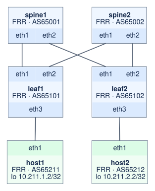

# Full L3 IP Clos

2 台の spine と 2 台の leaf を結ぶ IPv4 Clos。全リンクでインターフェース指定の eBGP Unnumbered を使う。各ホストはループバックの /32 を leaf に広告し、leaf から IPv6 next hop 付きの IPv4 デフォルトを学習する。対向ホストの /32 は2台の spine 経由で ECMP に入る。

## 論理構成



[図のソース](network.dot)

すべての実線は veth とその上の eBGP Unnumbered セッションを示す。

## 起動と検証

[共通セットアップ](../common/README.md)後、このディレクトリで実行する。

```bash
sudo containerlab deploy -t topology.clab.yml
sudo ./verify.sh
sudo ./verify.sh --failover
```

通常の検証では全6本の BGP セッション、両ホストが BGP から学んだデフォルト、対向 /32 の ECMP、ホスト間の双方向 ping を確認する。障害試験では leaf1 の spine1 側リンクを落とし、両 leaf の next hop が spine2 だけに収束した後の双方向 ping を確認する。復旧後は 2 経路への復帰と疎通を再確認する。スクリプトは試験失敗時もリンクを復元する。

```bash
sudo docker exec clab-full-l3-ip-clos-leaf1 vtysh -c 'show bgp ipv4 unicast summary'
sudo docker exec clab-full-l3-ip-clos-leaf1 vtysh -c 'show ip route 10.211.2.2/32'
sudo containerlab destroy --cleanup -t topology.clab.yml
```
