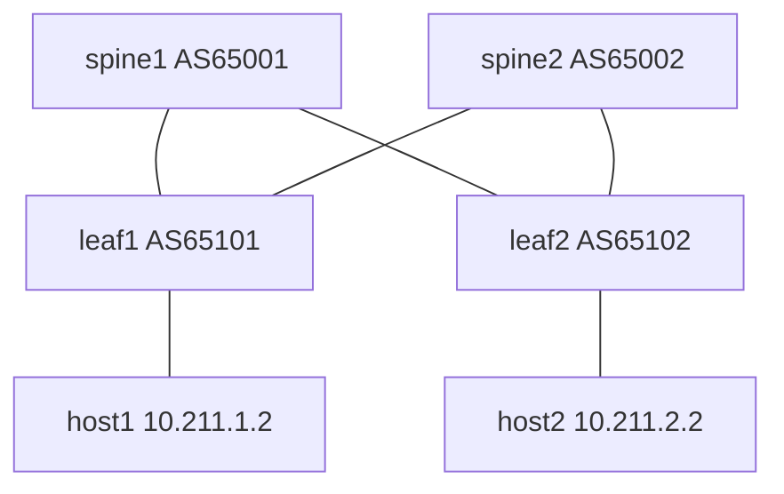

# Full L3 IP Clos

2 台の spine と 2 台の leaf を結ぶ IPv4 Clos。leaf–spine の各リンクは /31 で、ルーターごとに AS を割り当てる。各 leaf が直結するホスト用 /24 を eBGP で広告し、対向 leaf は 2 台の spine を ECMP next hop として使う。



| 接続 | データリンク |
| --- | --- |
| leaf1 – spine1 | 10.211.0.0/31 |
| leaf1 – spine2 | 10.211.0.2/31 |
| leaf2 – spine1 | 10.211.0.4/31 |
| leaf2 – spine2 | 10.211.0.6/31 |
| host1 – leaf1 | 10.211.1.0/24 |
| host2 – leaf2 | 10.211.2.0/24 |

## 起動と検証

[共通セットアップ](../common/README.md)後、このディレクトリで実行する。

```bash
sudo containerlab deploy -t topology.clab.yml
sudo ./verify.sh
sudo ./verify.sh --failover
```

通常の検証では全 4 本の BGP セッション、対向 /24 ごとの 2 経路の FIB 登録、ホスト間の双方向 ping を確認する。障害試験では leaf1 の spine1 側リンクを落とし、両 leaf の next hop が spine2 だけに収束した後の双方向 ping を確認する。復旧後は 2 経路への復帰と疎通を再確認する。スクリプトは試験失敗時もリンクを復元する。

```bash
sudo docker exec clab-full-l3-ip-clos-leaf1 vtysh -c 'show bgp ipv4 unicast summary'
sudo docker exec clab-full-l3-ip-clos-leaf1 vtysh -c 'show ip route 10.211.2.0/24'
sudo containerlab destroy --cleanup -t topology.clab.yml
```
