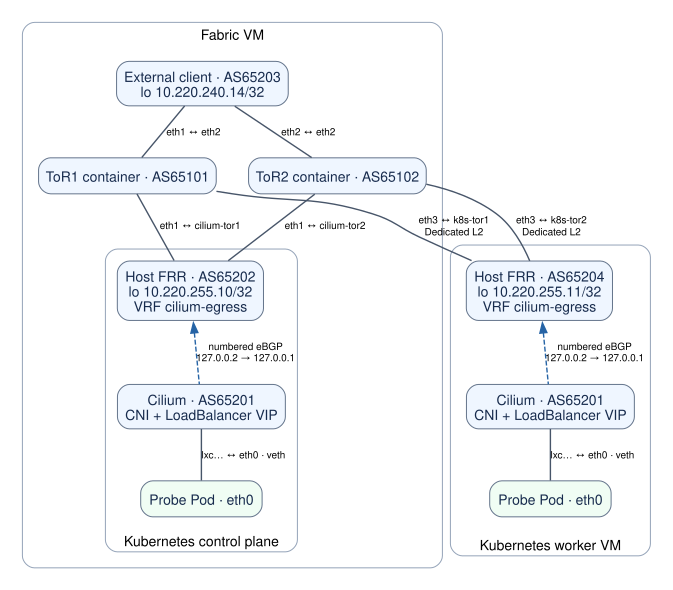

# Kubernetes Cilium Full L3 BGP on the Host

kubeadm の単一ノードで、Cilium は同じノード上の `node-frr` と eBGP Unnumbered を張る。ノードは `node-frr` のネットワーク名前空間にある独立した2本のインターフェースで、別々の ToR に接続する。Kubernetes の InternalIP と API のアドレスは `lo` の `10.220.255.10/32`。

## 検証ネットワーク



[図のソース](network.dot)

| 接続 | インターフェース |
| --- | --- |
| ノード — ToR1 / ToR2 | `node-frr:eth2` ↔ `tor1:eth1`、`node-frr:eth4` ↔ `tor2:eth1` |
| クライアント — ToR1 / ToR2 | `client:eth1` ↔ `tor1:eth2`、`client:eth2` ↔ `tor2:eth2` |
| Cilium — ノード FRR | `cilium-uplink` ↔ `node-frr:eth1` |
| ホスト名前空間の FRR — ノード FRR | `cilium-routes` ↔ `node-frr:eth3` |

表のすべてのリンクで eBGP Unnumbered を使う。Pod 用 veth のホスト側は Cilium が実行時に作成する。

- Cilium は `lo` のノード IP と LoadBalancer VIP `10.220.250.10/32` を `node-frr` に広告する。VIP の割り当てと広告対象は Cilium リソースで管理する。
- Cilium の `endpointRoutes.enabled` が Pod ごとの /32 を Linux に追加する。ホスト名前空間の `kube-host-frr` は Pod 範囲 `10.220.0.0/20` 内のカーネル /32 を再配布し、`node-frr` は両 ToR に広告する。Pod を削除すると対応する /32 が撤回される。 [Cilium の Pod 経路実装](https://github.com/cilium/cilium/blob/v1.21.0-pre.4/pkg/datapath/loader/endpoint.go#L239-L323)
- クライアントは両 ToR から IPv4 デフォルトを BGP で学ぶ。ノードは別 VRF のテーブル 220 に IPv6 next hop 付きのデフォルトを取り込み、Pod とノード IP の送信に使う。ノードの管理 NIC は管理ネットワークの経路を使う。

## 準備

[共通セットアップ](../common/README.md)を導入した Ubuntu 24.04 amd64 専用 VM で実行する。Kubernetes v1.34 系、Cilium 1.21.0-pre.4、containerd 2.x を使う。Cilium はインターフェース指定に対応するバージョンを固定している。 [Cilium 1.21.0-pre.4](https://github.com/cilium/cilium/releases/tag/v1.21.0-pre.4)

起動済みの旧環境を切り替える場合は、旧チェックアウトで `sudo ./lab.sh down` を実行する。Node IP の変更は専用 kubeadm クラスターの再作成で反映する。

```bash
./install-tools.sh
sudo ./lab.sh up
sudo ./lab.sh verify --failover
```

`up` は専用の containerd ソケットを使い、kubeadm、kube-proxy、Cilium、検証 Pod と Service を構成する。`verify` はノードの InternalIP、両 ToR のノード IP・Pod IP・VIP の BGP 経路、および IPv6 next hop 付きのデフォルトを照合する。`--failover` は ToR ごとに両データポートを停止し、もう一方の ToR でノードと Pod への ping、VIP への HTTP が通ることを確認する。

### Pod 個別経路の撤回

一時 Pod を作成し、IP の /32 が両 ToR に現れ、削除すると両方から消えることを確認する。

```bash
export KUBECONFIG=/etc/kubernetes/admin.conf
sudo -E kubectl -n lab-probe run withdrawal-probe --image=busybox:1.37.0 --restart=Never -- sleep 300
sudo -E kubectl -n lab-probe wait --for=condition=Ready --timeout=60s pod/withdrawal-probe
pod_ip=$(sudo -E kubectl -n lab-probe get pod withdrawal-probe -o jsonpath='{.status.podIP}')
for tor in tor1 tor2; do
  sudo docker exec "clab-cilium-l3-$tor" ip -4 route show exact "$pod_ip/32"
done
sudo -E kubectl -n lab-probe delete pod withdrawal-probe
for tor in tor1 tor2; do
  sudo docker exec "clab-cilium-l3-$tor" ip -4 route show exact "$pod_ip/32"
done
```

## 撤去

`down` はこのラボの kubeadm クラスター、ループバック IP、経路ポリシー、Containerlab トポロジー、専用 CRI サービスを撤去する。パッケージと CRI のイメージキャッシュは残る。初回構築が途中で失敗した場合も `down` の後に `up` を再試行できる。

```bash
sudo ./lab.sh down
```
