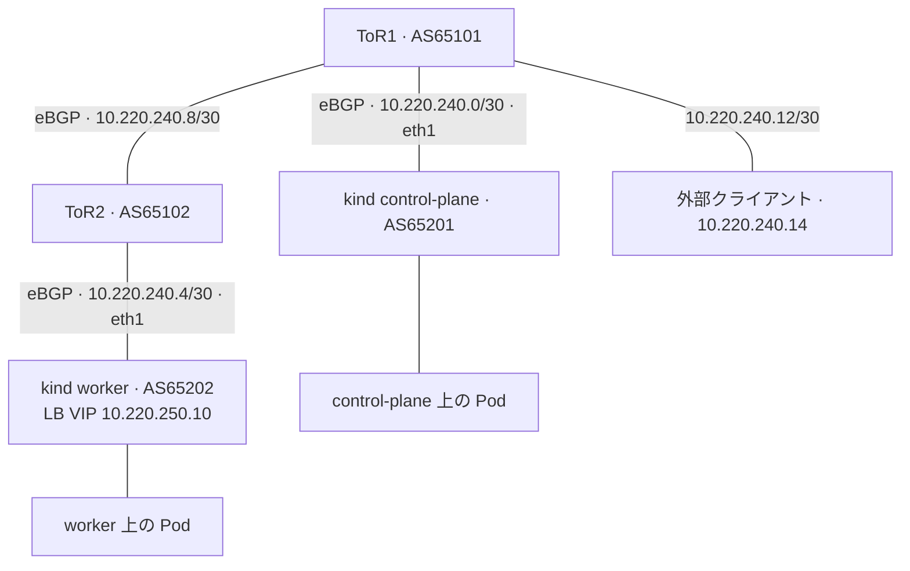

# Kubernetes Cilium Full L3 BGP on the Host

kind の各 Kubernetes ノードで Cilium の BGP speaker を動かし、ノード固有の PodCIDR を隣接する FRR ToR に eBGP で広告する。ToR 間は独立したルーテッドリンクで接続する。Pod 間と外部クライアントから Pod IP への通信を IPv4 native routing で検証する。LoadBalancer Service の VIP は、backend が Ready な worker からだけ広告し、外部から HTTP で応答を確認する。

## 論理構成



| 区間 | アドレス |
| --- | --- |
| control-plane → ToR1 | 10.220.240.2 → 10.220.240.1 |
| worker → ToR2 | 10.220.240.6 → 10.220.240.5 |
| ToR1 → ToR2 | 10.220.240.9 → 10.220.240.10 |
| external client → ToR1 | 10.220.240.14 → 10.220.240.13 |
| PodCIDR | 10.220.0.0/20 をノードごとに /24 で割り当て |
| LoadBalancer VIP | 10.220.250.10/32 |
| 管理ネットワーク | kind の Docker ブリッジと containerlab の 172.30.13.0/24 |

kubelet の InternalIP と Kubernetes API は kind 管理ネットワークを使う。Pod のデータ経路は各ノードの `eth1` を使い、VXLAN や Geneve を無効にする。Cilium BGP Control Plane は受信経路をノードの Linux FIB に書き込まないため、ノードから PodCIDR 全体とクライアントセグメントへの経路は ToR 向けに設定する。ToR はノードと対向 ToR から受け取った最長一致の PodCIDR を FIB に載せる。Cilium は 10.220.0.0/16 宛の通信で送信元 Pod IP を維持する。 [Cilium 1.18.17 BGP Control Plane](https://github.com/cilium/cilium/blob/v1.18.17/Documentation/network/bgp-control-plane/bgp-control-plane.rst) [Cilium 1.18.17 Helm values](https://github.com/cilium/cilium/blob/v1.18.17/install/kubernetes/cilium/values.yaml)

## 準備

[共通環境](../common/)を準備した Linux ゲストで実行する。Cilium の BPF 機能を使えるカーネルが必要。単独起動の目安は 4 vCPU、メモリ 8 GiB、空き容量 30 GiB。kind v0.30.0、Kubernetes v1.34.0、Cilium v1.18.17 を使用する。 [kind v0.30.0](https://github.com/kubernetes-sigs/kind/releases/tag/v0.30.0) [Cilium v1.18.17](https://github.com/cilium/cilium/releases/tag/v1.18.17)

`kind`、`kubectl`、`helm` が未導入なら、Linux x86_64 では以下でローカルに導入する。 [kind リリース](https://github.com/kubernetes-sigs/kind/releases/tag/v0.30.0) [kubectl インストール](https://kubernetes.io/docs/tasks/tools/install-kubectl-linux/) [Helm リリース](https://github.com/helm/helm/releases/tag/v3.19.5)

```bash
./install-tools.sh
```

## 起動と検証

このディレクトリで実行する。初回はコンテナイメージと Helm チャートを取得する。

```bash
sudo ./lab.sh up
sudo ./lab.sh verify
```

`up` の最後に `verify` を実行する。両方の ToR の Linux FIB に各 PodCIDR と VIP の所定の next hop が入り、ノードが対向ノードの Pod IP 宛に `eth1` を選ぶことを確認する。ノードをまたぐ Pod 間および外部から両 Pod への ICMP と、外部から LoadBalancer VIP への HTTP も検証する。

```bash
sudo kubectl --kubeconfig .lab-state/kubeconfig get nodes -o wide
sudo kubectl --kubeconfig .lab-state/kubeconfig get ciliumbgpnodeconfigs
sudo kubectl --kubeconfig .lab-state/kubeconfig -n lab-probe get service probe-worker
sudo docker exec clab-cilium-l3-tor1 vtysh -c 'show bgp ipv4 unicast summary'
sudo docker exec clab-cilium-l3-tor1 vtysh -c 'show ip route bgp'
sudo docker exec clab-cilium-l3-tor2 vtysh -c 'show ip route bgp'
```

### 経路の撤回と復旧

ToR2 の worker 向けセッションを停止し、worker の PodCIDR と VIP が両 ToR から消えることを確認する。

```bash
sudo docker exec clab-cilium-l3-tor2 vtysh \
  -c 'configure terminal' -c 'router bgp 65102' -c 'neighbor 10.220.240.6 shutdown'
sudo docker exec clab-cilium-l3-tor1 vtysh -c 'show ip route bgp'
sudo docker exec clab-cilium-l3-tor2 vtysh -c 'show ip route bgp'
worker_pod=$(sudo kubectl --kubeconfig .lab-state/kubeconfig -n lab-probe \
  get pod probe-worker -o 'jsonpath={.status.podIP}')
sudo docker exec clab-cilium-l3-client ping -c 2 -W 2 "$worker_pod"
sudo docker exec clab-cilium-l3-client wget -T 5 -O - http://10.220.250.10/
```

収束後、worker Pod への ping と VIP への HTTP は失敗し、control-plane 側の PodCIDR は残る。FRR の実行中の設定を戻し、再度検証する。

```bash
sudo docker exec clab-cilium-l3-tor2 vtysh \
  -c 'configure terminal' -c 'router bgp 65102' -c 'no neighbor 10.220.240.6 shutdown'
sudo ./lab.sh verify
```

## 撤去

```bash
sudo ./lab.sh down
```

containerlab を先に撤去してから、kind クラスターと専用 kubeconfig を削除する。トポロジー構築中に失敗した場合も `down` を実行してから `up` を再試行する。
