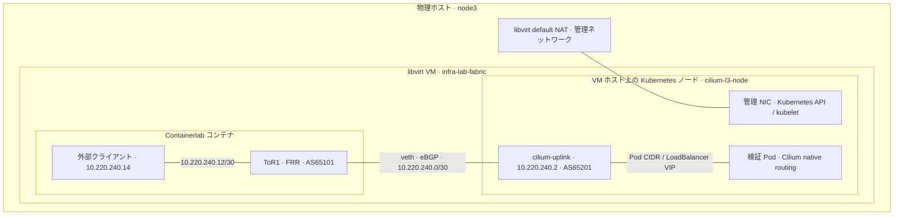

# Kubernetes Cilium Full L3 BGP on the Host

node3 の `infra-lab-fabric` VM を kubeadm で構築する単一 Kubernetes ノードとして使う。コントロールプレーンと Pod はこの VM 内で動く。Cilium はホストで FRR ToR に eBGP 接続し、Pod CIDR と LoadBalancer VIP を広告する。

## 物理・論理構成



| 対象 | アドレス |
| --- | --- |
| ToR → Kubernetes ノード | `10.220.240.1/30` → `10.220.240.2/30` |
| ToR → 外部クライアント | `10.220.240.13/30` → `10.220.240.14/30` |
| Pod ネットワーク | `10.220.0.0/20` から kubeadm がノード用 /24 を割り当て |
| Service ネットワーク | `10.221.0.0/16` |
| LoadBalancer VIP | `10.220.250.10/32` |
| Containerlab コンテナ管理ネットワーク | `172.30.13.0/24` |

外部クライアントの通信は ToR と `cilium-uplink` を通る。ノードにはクライアントセグメントへの戻り経路を設定する。Docker の転送チェーンにはこのリンク、クライアント範囲、Pod 範囲に限定した許可を追加する。

## 準備

[共通環境](../common/README.md)を導入済みの Ubuntu 24.04 amd64 専用 VM で実行する。Kubernetes v1.34 系、Cilium 1.18.17、containerd 2.x を使用する。Kubernetes 用 CRI は専用の containerd プロセス、ソケット、データディレクトリを使う。[kubeadm の導入手順](https://kubernetes.io/docs/setup/production-environment/tools/kubeadm/install-kubeadm/) [containerd の設定](https://kubernetes.io/docs/setup/production-environment/container-runtimes/)

Cilium ラボを以前の手順で起動済みなら、更新前のチェックアウトでそのラボの `sudo ./lab.sh down` を実行してから切り替える。

```bash
./install-tools.sh
```

## 起動と検証

```bash
sudo ./lab.sh up
sudo ./lab.sh verify
```

`up` は Containerlab を起動し、kubeadm、kube-proxy、Cilium、検証 Pod と Service を構成する。検証では ToR の Linux FIB に Pod CIDR と VIP が入り、外部クライアントから Pod IP に ping、VIP に HTTP で到達できることを確認する。

```bash
sudo kubectl --kubeconfig /etc/kubernetes/admin.conf get nodes -o wide
sudo kubectl --kubeconfig /etc/kubernetes/admin.conf -n lab-probe get pod,svc -o wide
sudo docker exec clab-cilium-l3-tor1 vtysh -c 'show bgp ipv4 unicast summary'
sudo docker exec clab-cilium-l3-tor1 vtysh -c 'show ip route bgp'
```

### 経路の撤回と復旧

ToR の Kubernetes ノード向けセッションを一時停止すると、収束後に Pod CIDR と VIP が ToR の FIB から消える。確認後にセッションを復旧して再検証する。

```bash
sudo docker exec clab-cilium-l3-tor1 vtysh \
  -c 'configure terminal' -c 'router bgp 65101' -c 'neighbor 10.220.240.2 shutdown'
sudo docker exec clab-cilium-l3-tor1 vtysh -c 'show ip route bgp'
sudo docker exec clab-cilium-l3-tor1 vtysh \
  -c 'configure terminal' -c 'router bgp 65101' -c 'no neighbor 10.220.240.2 shutdown'
sudo ./lab.sh verify
```

## 撤去

`down` はこのラボの kubeadm クラスターをリセットし、このラボの転送ルール、Containerlab トポロジー、専用 CRI サービスを撤去する。パッケージと CRI のイメージキャッシュは残る。初回構築が途中で失敗した場合も `down` の後に `up` を再試行できる。

```bash
sudo ./lab.sh down
```
