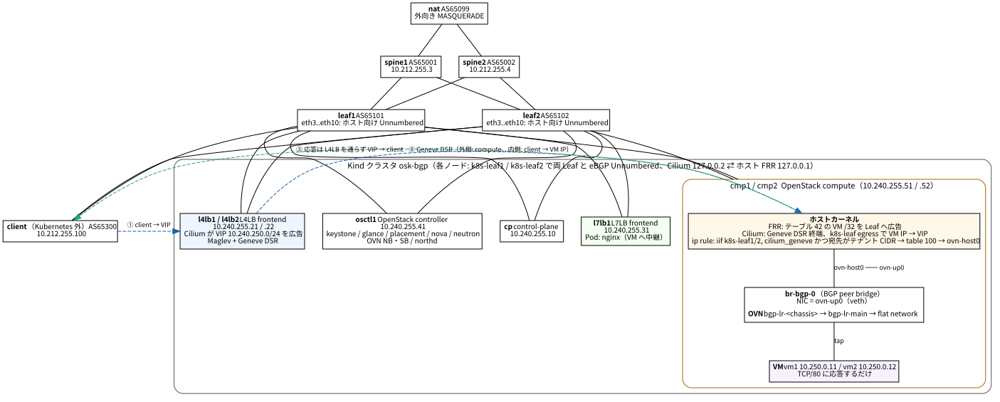

# OpenStack on Kubernetes + Cilium DSR + OVN BGP Service Plugin

Kubernetes（Cilium、kube-proxy なし、Full L3 BGP on the Host）の上で OpenStack（ML2/OVN、Neutron 組み込みの `ovn-bgp` service plugin）を動かし、Cilium の L4LB が DSR で OpenStack VM または L7LB にクライアント IP を保持したまま転送できるかを検証する。

## 要件

- OpenStack は Kubernetes 上で動かす。compute ノードの各サービスも `hostNetwork: true` の DaemonSet。
- CNI は Cilium。`kubeProxyReplacement=true`、BGP Control Plane、DSR、トンネルなし（native routing）。
- Kubernetes ノードは Full L3 の BGP on the Host。Cilium の BGP はホストの FRR とピアを張る。
- Neutron は ML2/OVN + `ovn-bgp` service plugin。テナントネットワークは flat で、VM の固定 IP を BGP で広告する。Neutron ルーターと Floating IP は使わない。
- ノードグループは L4LB frontend / L7LB frontend / OpenStack controller / OpenStack compute。
- L4LB は Cilium DSR（IPIP または Geneve）で OpenStack VM または L7LB に転送し、クライアント IP を保持する。
- VM はサービスを処理するだけで、L4LB・DSR・VIP を知らない。VM 内でトンネル終端や VIP の保持をしない。

## 検証する仮説と合否条件

| # | 仮説 | 合格条件（観測点） |
| --- | --- | --- |
| H1 | 全ノードが両 Leaf と eBGP Unnumbered を張り、Cilium はホスト FRR とだけピアを張る構成で、L4LB ノード群だけが VIP を広告できる | Leaf の FIB で VIP が L4LB 2 台の ECMP。他ノードから VIP 経路が出ない |
| H2 | L4LB → L7LB ノード上の Pod へ Geneve DSR で転送でき、クライアント IP が保持される | 外部クライアントからの HTTP 応答内の送信元がクライアントのループバック IP |
| H3 | `ovn-bgp` plugin を使い、compute ノードが VM 固定 IP /32 を両 Leaf に広告・撤回できる | Leaf / Spine の FIB に VM /32、VM 削除で撤回、クライアントから VM へ ping |
| H4 | L4LB → VM へ DSR で転送でき、VM は何も知らないままクライアント IP を見る。応答は L4LB を経由しない | VM の tap 上で送信元がクライアント IP・宛先が VM 固定 IP。クライアントは VIP から応答を受ける。L4LB ノードに戻りパケットが現れない |
| H5 | Leaf 片系断・復旧を通じて H2〜H4 の通信が継続する | 片系断中と復旧後に同じ HTTP 要求が成功 |

## 結論（2026-11-25 時点）

要件を満たす実装ができた。採用した構成は次の組み合わせ。

- compute ノードは「候補 B: ホストカーネル経由」。Leaf 向け NIC はホストカーネルが持ち、`ovn-bgp` の BGP peer bridge にはホストと結ぶ veth を収容する。plugin とエージェント拡張は無改造。
- DSR は Geneve dispatch。VM 宛ては「セレクタなし Service + EndpointSlice（VM 固定 IP）」と「CiliumEndpoint（VM IP → compute ノード）」の 2 つを登録する。
- VM（cirros）は TCP/80 に応答するだけで、VIP もトンネルも持たない。



[図のソース](network.dot)

## 実機検証結果（2026-11-25）

`infra-lab-switches`（Ubuntu 24.04、16 vCPU / 47 GiB、Docker / Containerlab 0.83.0 / Kind v0.27.0（Kubernetes v1.32.2）/ FRR 10.4.1 / Cilium 1.21.0-pre.4 / openstack-helm `1c45752` + OpenStack 2026.2 イメージ / OVN 26.03.0 / OVS 3.7.1）で確認した。

| # | 結果 | 観測 |
| --- | --- | --- |
| H1 | 合格 | 全 7 ノードで `k8s-leaf1` / `k8s-leaf2` / Cilium（`127.0.0.2`）の 3 ピアが Established。両 Leaf の FIB で VIP 4 個が L4LB 2 台（`eth5` / `eth6`）の ECMP |
| H2 | 合格 | `http://10.240.250.10/` の応答で `RemoteAddr: 10.212.255.100`（クライアントのループバック） |
| H3 | 合格 | `10.250.0.11/32` は cmp1（`eth9`）、`10.250.0.12/32` は cmp2（`eth10`）だけを次ホップに両 Leaf へ入る。クライアントから ping / HTTP 成功。vm2 削除で `/32` が両 Leaf から撤回、再作成で再広告 |
| H4 | 合格 | VM の tap で `10.212.255.100 → 10.250.0.x:80` の SYN、compute の Leaf 向け NIC から `10.240.250.20:80 → 10.212.255.100` の応答、L4LB 2 台では戻りパケット 0 |
| H5 | 合格 | leaf1・leaf2 それぞれのホスト向けポート全断と復旧を通じて、経路の収束後に H2〜H4 と L7LB 経由の HTTP が成功 |
| L7LB | 合格（2 配置） | 専用ワーカー（VIP `.30`）と compute の DaemonSet（VIP `.31`）のどちらも、L7LB が見た送信元がクライアントのループバック（`X-L7LB-Client`）で、VM の応答を中継 |

`sudo ./verify.sh`、`sudo ./verify.sh --failover`、`sudo ./verify.sh --withdraw` がいずれも `ALL PASS`。

撤去からの通し実行（`sudo ./rebuild.sh`: `lab.sh down` → `lab.sh up` → `openstack.sh up` → `vm.sh up` → `lab.sh workloads` → `verify.sh --failover` → `verify.sh --withdraw`）も終了コード 0 で通過し、手作業なしで同じ結果を再現できることを確認した。

### 未検証・未達

- **候補 A（plugin 既定の ToR 直結）での DSR**: 実機では試していない。VM のトラフィックがホストカーネルを通らないことはエージェント拡張のフロー（`in_port=NIC` を LRP へ直送）から読み取ったもので、観測ではない。
- **L7LB を VM に置く配置**: 未実施。L4LB → VM の DSR（H4）と同じ経路になるため成立する見込みだが、L7LB として動かしてはいない。
- **IPIP dispatch**: 実機では試していない。VM IP 宛ての IPIP が終端されないという判断はソース（`bpf_host.c` の `lookup_ip4_endpoint` 条件）による。
- **バックエンドのヘルスチェック**: VM 削除後も EndpointSlice に残した VM IP へ L4LB が振り分け続ける。Neutron のポート状態から EndpointSlice / CiliumEndpoint を同期する仕組みは作っていない（[vm-backend.sh](vm-backend.sh) は静的な登録）。
- **ライブマイグレーション**: VM が別 compute に移ると CiliumEndpoint のノードを書き換える必要がある。未検証。
- **OVN の Geneve トンネル**: Cilium の `cilium_geneve` が UDP 6081 を使うため、OVN のトンネルポートは `Device or resource busy` で作成に失敗する。テナントが flat のみでトンネルを使わないため本検証には影響しなかったが、Geneve テナントネットワークを併用する場合はどちらかのポートを変える必要がある。
- **MTU**: Geneve DSR のオーバーヘッド分の MTU 調整と、大きなパケットでの挙動は確認していない（Containerlab の veth は MTU 9500）。
- **XDP 加速、IPv6、複数 flat サブネット**: 未検証。

## 設計

### compute ノードのデータパス

VM が DSR を知らない以上、DSR の終端（デカプセル化）と戻りの送信元書き換え（VM IP → VIP）は compute ノードで行う必要がある。Cilium の DSR はこの 2 つを受信ノードの BPF で行うので、VM の往復トラフィックが compute ノードの Cilium を通るかどうかが分かれ目になる。

| 候補 | 構成 | 評価 |
| --- | --- | --- |
| A: plugin 既定（ToR 直結 NIC を OVS に収容） | Leaf 向け NIC を BGP peer bridge（`br-bgp-N`）に入れ、ホストはブリッジのローカルポート経由で通信する。[既存ラボ](../openstack-ovn-bgp-service-plugin/) と同じ | VM のトラフィックは NIC ↔ OVS ↔ OVN で完結し、ホストカーネルと Cilium を通らない。compute ノードで DSR を終端しても、VM の応答が Cilium を通らず VIP に書き戻せない（未検証・コードからの判断） |
| B: ホストカーネル経由（採用） | Leaf 向け NIC はホストカーネルが持つ（他の Kubernetes ノードと同じ）。BGP peer bridge の「NIC」は veth とし、対向をホストカーネルに置く。OVN から見た BGP ピアは ToR ではなくホスト自身 | VM の往復がホストの経路表と Cilium の BPF（Leaf 向け NIC の egress）を通る。全ノードの対 Leaf 構成が同一になる。実機で H3〜H5 を確認 |

候補 B の compute ノード内の配線（[node-prep.sh](node-prep.sh)、[frr/compute.conf.j2](frr/compute.conf.j2)）:

```
Leaf ─ k8s-leaf1/2 ─ [ホストカーネル: FRR + Cilium] ─ ovn-host0 ══ ovn-up0 ─ br-bgp-0 ─ bgp-lr-<chassis> ─ bgp-lr-main ─ flat network ─ VM
```

| 方向 | 仕組み |
| --- | --- |
| 広告 | OVN（`bgp-lr-main`、VRF ID 42）がローカル VM の `/32` をテーブル 42 に blackhole で入れる。FRR は `vrf ovnvrf42` の kernel 経路を default VRF に import して両 Leaf へ広告する。FIB には入れない |
| fabric → VM | `ip rule iif k8s-leaf1/2 to <テナント CIDR> lookup 100`。テーブル 100 のデフォルトは `ovn-host0` 上の LRP リンクローカル。エージェント拡張のフローが peer bridge で宛先 MAC を LRP に揃える |
| VM → fabric | chassis ルーター（VRF ID 10）がテーブル 10 のデフォルト（次ホップ `ovn-host0` のリンクローカル、`dev br-bgp-0`）を学習する。ホストはメイン経路表のデフォルト（両 Leaf の ECMP）で転送する |
| DSR 受信 | L4LB が compute のノード IP 宛てに Geneve で送る。`cilium_geneve` の BPF が Geneve オプションの VIP を CT に記録し、内側（宛先 VM IP）を `iif cilium_geneve` のルールで OVN に渡す |
| DSR 応答 | VM の応答が `ovn-host0` から入り、Leaf 向け NIC の egress（`cil_to_netdev`）で送信元が VM IP:port から VIP:port に書き戻される |

テナント CIDR をホストのポリシールールに書く点は妥協している。代替は、テーブル 42 の `/32` をメイン経路表の転送経路に写す常駐プロセスで、CIDR の記述が不要になり Pod → 同一 compute 上の VM も Leaf で折り返さずに済むが、部品が 1 つ増える。未検証。

### DSR のカプセル化

| 候補 | 外側宛先 | 内側パケット | VM 宛ての成立条件 |
| --- | --- | --- | --- |
| Geneve（採用） | バックエンドを収容するノード | DNAT 済み（宛先は VM IP:port）。VIP は Geneve オプション | L4LB の ipcache に「VM IP → compute ノード」のトンネル終端が必要（なければ `DROP_NO_TUNNEL_ENDPOINT`）。受信側は CT に VIP を記録し、戻りを Leaf 向け NIC の egress で書き戻す。実機で確認 |
| IPIP | バックエンド IP 自体 | 未変換（宛先は VIP） | 受信ノードの終端は外側宛先がローカルエンドポイント（Pod / ホスト IP）のときだけ。VM IP は該当しないため、カプセル化されたまま VM に届く（Cilium 1.21.0-pre.4 のソースからの判断、未検証） |

### L7LB の配置

| 配置 | 状態 | 観測 |
| --- | --- | --- |
| 専用の Kubernetes ワーカー（L7LB frontend） | 動作確認済み | VIP `10.240.250.30`。L7LB → VM は fabric 経由 |
| OpenStack compute ノードの DaemonSet | 動作確認済み | VIP `10.240.250.31`。同一 compute 上の VM 宛ても一度 Leaf で折り返す（ホスト発・Pod 発の通信は OVN に直接入れないため） |
| VM | 未実施 | — |

比較は未実施。

## 実機で得た知見

- **Cilium は local テーブル参照を pref 100 に移す**。compute のポリシールールをそれより前に置くと、ノード宛ての通信まで OVN に流れて kubelet が API に届かず NotReady になる。ルールは pref 111 に置いた。
- **`iif` だけのポリシールールは Cilium の戻り処理と衝突する**。Cilium は DSR 応答を書き戻す際、Leaf 向け NIC を入力 IF として `bpf_fib_lookup` を行う（`nodeport_rev_dnat_fwd_ipv4`）。`iif k8s-leaf*` のルールがこの検索に一致し、応答が書き戻されないまま `ovn-host0` に折り返した。宛先をテナント CIDR に限定して解消した。
- **CiliumEndpoint による ipcache 登録**。`status.networking.node` に compute のノード IP、`addressing` に VM IP を持つ CiliumEndpoint を作ると、全ノードの ipcache に `tunnelendpoint=<compute>` が入り Geneve DSR が成立する。`ownerReferences` を Pod 以外（Node）にすると cilium-operator の CEP GC 対象外になる。一方 agent は起動時に「自ノード IP を持つがローカルに実体がない」CEP を削除するため、`enable-stale-cilium-endpoint-cleanup=false` が必要だった（無効化前は agent 再起動で VIP → VM が止まった）。
- **Pod → VM は MASQUERADE させない**。`ipv4NativeRoutingCIDR` の外だと送信元がノード IP になり、同一 compute 上の VM 宛てが Leaf で折り返して戻った際に martian source として破棄される。VM のレンジを含む `10.240.0.0/12` にした。
- **OVN が学習する経路のプロトコル**。テーブル 10 のデフォルトは `proto static` / `boot` では学習されず、`ra`・`bgp`・番号 250 では学習された。番号 250 を使っている。
- **OVN の近隣要請**。chassis ルーターは IPv6 リンクローカル次ホップの解決に `ff02::1:ffff:ffff` 宛ての近隣要請を送り、ホストカーネルは応答しなかった。ホスト → OVN の次ホップを LRP のリンクローカルにして、ホスト側の近隣要請から OVN に MAC を学習させて解消した。
- **openstack-helm と `ovn-bgp` の組み合わせで必要だった調整**（[openstack/](openstack/)、[openstack.sh](openstack.sh)）:
  - `ovn-controller` は既定の `openvswitch` ユーザーだと capability が落ち、`Unable to create VRF ovnvrf42: Operation not permitted` になる。root で動かし、`/run/openvswitch` の所有者が変わるため OVS も root に揃えた。
  - OSH の `auto_bridge_add` はブリッジを `protocols=OpenFlow13` で作り、Pod 再起動のたびに戻す。エージェント拡張は OpenFlow10 でフローを入れるため失敗する。ブリッジは `openstack.sh` で作る。
  - エージェント拡張は起動時点で存在する peer bridge にフローを入れない。Bridge 行を更新して契機を与える（`openstack.sh kick`）。
  - OVS の `neutron-bgp-peer-bridges` / `neutron-bgp-interconnect-bridge` は OSH が設定しないため `openstack.sh` で入れる。
  - OVN 用 override（libvirt の `neutron-ovs-agent` 依存の解除、OVSDB の TCP 6640 待ち受け）、Neutron の `default_availability_zones` 解除（ゲートウェイ chassis がなくネットワーク AZ が存在しない）、glance の staging 用 StorageClass。
  - `ovn-encap-ip` 用に、ノードのループバック IP を載せたダミー IF（`ovn-encap0`）を作っている。
- **VM ゲートウェイ `10.250.0.1/32` も両 compute から広告される**（plugin の `connected-as-host`）。Leaf では 2 台の ECMP になる。
- **Containerlab のバインドマウントと Ansible**。`template` はファイルを置き換えるため、稼働中コンテナからは古い内容が見え続ける。稼働中の FRR へは標準入力で流し込む必要があった（再デプロイなら不要）。

## 他のラボとの共存

同じホストで他の Containerlab / Kind ラボが動いていても衝突しないよう、次を専用にしている。

| 対象 | 値 |
| --- | --- |
| Containerlab ラボ名 / 管理ネットワーク | `osk-bgp` / `clab-osk-bgp-mgmt`（`172.20.22.0/24`） |
| Kind クラスタ名 / Docker ネットワーク | `osk-bgp` / `kind-osk-bgp`（`172.20.24.0/24`、`KIND_EXPERIMENTAL_DOCKER_NETWORK`） |
| kubeconfig | このディレクトリの `osk-bgp.kubeconfig`（`~/.kube/config` を書き換えない） |
| アドレス | ノード `10.240.255.0/24`、Pod `10.240.0.0/20`、Service `10.241.0.0/16`、VIP `10.240.250.0/24`、VM `10.250.0.0/24`、fabric `10.212.255.0/24` |

ホスト全体に効く変更は `fs.inotify.max_user_instances=8192`（Kind クラスタ 3 つ分の inotify 不足を避けるための引き上げ、再起動で元に戻る）だけ。

## 構成ファイル

Containerlab Desktop では、上から NAT、Spine、Leaf、接続ノードの順に表示する。初回のレンダリングで表示用 JSON をトポロジーの隣に配置し、以後は Desktop で保存した配置を保持する。

- [nodes.yml](nodes.yml): ノード・ASN・アドレスの単一の定義。[render.yml](render.yml) が FRR 設定（[frr/](frr/)）、Containerlab トポロジー、Kind クラスタ定義（[templates/](templates/)）を `rendered/` に生成する。
- [lab.sh](lab.sh): fabric・Kind・Cilium（[cilium-values.yaml](cilium-values.yaml)、[bgp.yaml](bgp.yaml)）。
- [openstack.sh](openstack.sh) / [openstack/](openstack/): openstack-helm の導入と values。[node-prep.sh](node-prep.sh): compute ノードのホスト側ネットワーク。
- [vm.sh](vm.sh): flat provider network と VM。[vm-backend.sh](vm-backend.sh): VM を L4LB のバックエンドに登録。
- [pod-probe.yaml](pod-probe.yaml) / [l7lb.yaml](l7lb.yaml): Pod 向け DSR の確認用ワークロードと L7LB。
- [verify.sh](verify.sh): H1〜H5 の照合。[rebuild.sh](rebuild.sh): 撤去から検証までの通し実行。

## 構築と検証

[共通セットアップ](../common/README.md)（Docker / Containerlab / Ansible / FRR イメージ）と [Kind・kubectl・helm](../k8s-cilium-full-l3-bgp-on-the-host/install-tools.sh) の導入後に実行する。OpenStack の導入には 20〜30 分かかる。

```bash
sudo ./lab.sh up
sudo ./openstack.sh up
sudo ./vm.sh up
sudo ./lab.sh workloads
sudo ./verify.sh
sudo ./verify.sh --failover
sudo ./verify.sh --withdraw
```

Kubernetes と OpenStack の操作:

```bash
sudo kubectl --kubeconfig osk-bgp.kubeconfig get nodes -L lab.infra/group
sudo ./vm.sh os server list --long
```

## 撤去

```bash
sudo ./openstack.sh down
sudo ./lab.sh down
```
