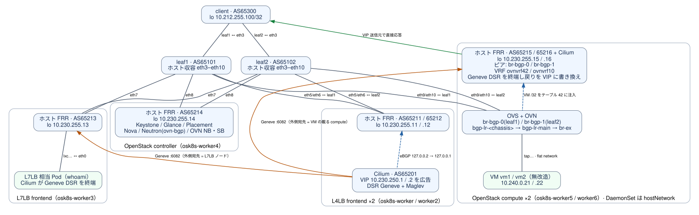

# OpenStack on Kubernetes + Cilium DSR L4LB

Kubernetes 上に OpenStack（ML2/OVN + Neutron 組み込みの `ovn-bgp` service plugin）を載せ、Cilium の L4LB が DSR で OpenStack VM と L7LB にクライアント IP を保持したまま転送する構成を検証する。

**現在の段階: 要件を満たす実装が 1 つ成立することを実機で確認した。L7LB 配置 3 案の比較は未実施。**

## 検証した仮説と合否条件

| 仮説 | 合否条件 | 結果 |
| --- | --- | --- |
| Cilium（KPR・native routing・BGP Control Plane）の L4LB が、DSR で専用 worker 上の L7LB にクライアント IP を保持して転送できる | L7LB から見た接続元がクライアントのループバック IP。L7LB ノードでカプセル化された受信と VIP 送信元の直接応答を観測 | 合格 |
| 同じ L4LB が、OpenStack VM（固定 IP）に DSR で転送できる。VM とテナントには DSR 用の設定を求めない | VM から見た接続元がクライアント IP、宛先が VM 自身の固定 IP。クライアントには VIP から応答が返る。両 compute の VM に分散。VM 内にトンネル・VIP なし、SG はステートフル、allowed-address-pairs なし | 合格 |
| compute を k8s の hostNetwork DaemonSet として動かし、`ovn-bgp` が flat network 上の VM 固定 IP を /32 で広告する | Leaf で VM /32 が VM の載る compute のポートだけから学習され、クライアントから ping が通る | 合格 |
| compute ノードで Leaf 向け NIC を OVS に収容しても、ホスト FRR と Cilium が動き続ける | NIC 収容後に BGP がブリッジ内部ポートで確立し、ノード Ready、ノード IP に到達 | 合格 |
| Leaf 片系断と復旧で経路と疎通が維持される | `verify.sh --failover` が終了コード 0 | 合格 |

## 構成



[図のソース](network.dot)

このホスト（`kan-containerlab`、Ubuntu 24.04.5、16 vCPU / 47 GiB、nested KVM）上の Kind 7 ノードクラスタ `osk8s` を、専用の Containerlab トポロジー `osk8s`（2-Spine / 2-Leaf + NAT + 検証クライアント）に収容する。既存の `full-l3-ip-clos` / `cilium-l3` とは別のクラスタ・トポロジーで、互いに接続しない。

| Kind ノード | グループ（`infra-lab/group`） | ノード IP（lo） | ASN | Leaf ポート |
| --- | --- | --- | --- | --- |
| `osk8s-control-plane` | Kubernetes control plane | 10.230.255.10 | 65210 | eth4 |
| `osk8s-worker` / `worker2` | `l4lb` | 10.230.255.11 / .12 | 65211 / 65212 | eth5 / eth6 |
| `osk8s-worker3` | `l7lb` | 10.230.255.13 | 65213 | eth7 |
| `osk8s-worker4` | `os-controller` | 10.230.255.14 | 65214 | eth8 |
| `osk8s-worker5` / `worker6` | `os-compute` | 10.230.255.15 / .16 | 65215 / 65216 | eth9 / eth10 |

- **BGP on the host**: 各 Kind ノードのネットワーク名前空間で FRR 10.4.1 を動かし、両 Leaf と eBGP Unnumbered を張る。Cilium（AS65201）は `127.0.0.2 → 127.0.0.1` でホスト FRR とピアを張る。
- **Cilium 1.20.5**: `kubeProxyReplacement: true`、`routingMode: native`、`loadBalancer.mode: dsr`、`dsrDispatch: geneve`（`tunnelPort: 6082`）、`algorithm: maglev`。Pod 間通信はトンネルを使わず、Geneve は DSR の転送だけに使う。VIP は `CiliumBGPClusterConfig` の nodeSelector で L4LB グループだけが広告する。
- **OpenStack**: OpenStack-Helm 2026.2 チャート + `2026.2-ubuntu_resolute` イメージ。OVN 26.03.0 / OVS 3.7.1。`service_plugins = ovn-router,ovn-bgp`、OVN Neutron Agent の拡張は `metadata,ovn-bgp`。
- **compute**: `openvswitch`・`ovn-controller`・`neutron-ovn-agent`・`libvirt`・`nova-compute`・`chassis-prep` の 6 DaemonSet がすべて `hostNetwork: true`。Leaf 向け NIC `leaf1` / `leaf2` を OVS の `br-bgp-0` / `br-bgp-1` に収容し、FRR はブリッジの内部ポートでピアを張る。Cilium は NIC と内部ポートの両方に付ける（`devices: "leaf+ br-bgp+ lo"`）。
- **VM の所在の公開**: [vm-endpoint-sync](vm-endpoint-sync.yaml) が Neutron ポートの「固定 IP → 収容 compute」を `CiliumEndpoint`（namespace `openstack-vms`、identity は world）として登録する。
- **tenant network**: flat network `tenant-flat`（physnet `public`、10.240.0.0/24、DHCP 有効）。Neutron ルーターと Floating IP は作らない。

## DSR の終端方式

VM に届ける DSR をどこで終端するかを 2 案、実機で試した。Cilium の DSR dispatch はクラスタ全体で 1 つなので、この選択がカプセル化方式を決める。

| 案 | 方式 | 実機の結果 | 判定 |
| --- | --- | --- | --- |
| A | **VM 内で終端**。`dsrDispatch: ipip`。L4LB が VM 固定 IP 宛てに IPIP を送り、VM が `tunl0` で受け、VIP を `lo` に持って直接応答する | 疎通・片系断とも合格。ただし VM に IPIP と VIP の設定、ポートに allowed-address-pairs、SG はステートレス + IP プロトコル 4 の許可が必要 | **却下**。テナントの VM に DSR 用の設定を求めるため使い勝手が悪い。VM が k8s user cluster のノードである場合だけは許容する（下の設計案） |
| B | **compute ノードの Cilium で終端**。`dsrDispatch: geneve`。L4LB が VM の載る compute ノード宛てに Geneve を送り、compute の Cilium が受けて VM へ渡し、戻りの送信元を VIP に書き換える | 疎通・片系断とも合格。VM は無改造、SG はステートフル、allowed-address-pairs 不要 | **採用** |

### 案 B の仕組み

1. L4LB の Cilium は宛先を VM 固定 IP に DNAT し、VIP を Geneve オプションに入れて、VM 固定 IP の「トンネル端点」へ送る。端点は `CiliumEndpoint` の `status.networking.node`（compute のノード IP）から決まる。VM の `CiliumEndpoint` がないと `DROP_NO_TUNNEL_ENDPOINT` で破棄される（未登録の状態でタイムアウトすることを確認）。
2. compute ではノード IP 宛ての Geneve がホストに渡り、`cilium_geneve` で外される。Cilium は DSR の対応（クライアント ↔ VM ↔ VIP）を記録し、内側のパケット（クライアント IP → VM 固定 IP）をホストの経路で送り出す。パケットは Leaf で折り返して同じ compute の NIC に戻り、OVN 経由で VM に届く。
3. VM の応答（VM 固定 IP → クライアント IP）は、compute の Cilium が送信元を VIP に書き換えて Leaf へ出す。compute のキャプチャで `10.230.250.2.80 > 10.212.255.100` が Leaf 向け NIC から出ることを確認した。

- **Geneve のポート**: OVN の `genev_sys_6081` と同じ UDP 6081 は使えない（カーネルは同一ポートに外部制御の Geneve デバイスを 1 つしか許さない）ため、Cilium 側を 6082 にした。6081 のまま衝突する様子は試していない。
- **`CiliumEndpoint` の流用**: Cilium の文書は「cilium-agent が Pod ごとに作る」オブジェクトとして説明しており（`Documentation/network/kubernetes/ciliumendpoint.rst`、`Documentation/internals/cilium_operator.rst`）、利用者が作る手順の記載はない。使っている IP・収容ノード・identity は `status` 側のフィールドでもある。動作は実機で確認したが、公式ドキュメントに記載のない使い方で、バージョン更新で動かなくなる可能性がある（非サポートと明記した文書は見つけていない。推定）。Pod 以外の IP を ipcache に載せる正規の手段が上流にあるかは未調査。
- **オペレーターによる回収への対処**: cilium-operator は対応する Pod のない `CiliumEndpoint` を約 5 分周期で回収する。owner なしで作ると実際に回収され、作り直すまで VM 宛ての DSR が途切れた。回収を止める `operator.endpointGCInterval: 0s` は、identity の回収と両立せずオペレーターが起動しなかった。回収ロジック（[`operator/endpointgc/gc.go`](https://github.com/cilium/cilium/blob/v1.21.0-pre.4/operator/endpointgc/gc.go)）は Pod 以外の owner を持つものを対象外にするため、収容 compute の `Node` を owner にしている。

## 実機検証結果（2026-11-25）

- **L4LB → L7LB（専用 worker の Pod）**: `http://10.230.250.1/` の応答で `RemoteAddr: 10.212.255.100`（クライアント）。L7LB ノードのキャプチャで、行きは L4LB ノードから L7LB ノード宛ての Geneve（UDP 6082）、戻りは `10.230.250.1.80 > 10.212.255.100` が Leaf へ直接出ることを確認した。
- **L4LB → OpenStack VM（案 B、採用）**: `http://10.230.250.2/` の応答で `RemoteAddr: 10.212.255.100`、`LocalAddr` は VM 自身の固定 IP、`Hostname` は `vm1` と `vm2` の両方。VM は接続元を返す HTTP サーバーだけを持ち、SG はステートフル、allowed-address-pairs なし。
- **戻りが L4LB を通らないこと（案 B）**: クライアントから `10.230.250.2` へ 8 回アクセスし、L4LB 2 台と compute 2 台で同時にキャプチャした。L4LB はクライアント → VIP を 29 / 17 件受けて同数の Geneve（UDP 6082）を送出し、VIP → クライアントは 0 件。compute は Geneve を 31 / 15 件受信し（合計 46 件で L4LB の送出と一致）、VIP → クライアントは compute からだけ出た。L7LB 向け VIP では同じ採取をしていない。
- **L4LB → OpenStack VM（案 A、却下）**: 切り替え前に、VM 内 IPIP 終端でも同じ疎通と片系断を確認した。この案ではステートフル SG だと VM の SYN-ACK が OVN で破棄され、ステートレス SG で通った。
- **Pod → VM**: controller ノードの Pod から `http://10.240.0.21/` に到達（接続元はノード IP に SNAT）。
- **VM 固定 IP の広告**: 両 Leaf で `10.240.0.21/32` は eth9（cmp1）、`10.240.0.22/32` は eth10（cmp2）からのみ学習。クライアントから両 VM へ ping 損失 0%。
- **VIP の広告**: 両 Leaf で `10.230.250.1/32` と `10.230.250.2/32` は eth5 / eth6（L4LB 2 台）の 2-way ECMP。
- **片系断と復旧**: `sudo ./verify.sh --failover` が正常時・leaf1 断・復旧・leaf2 断・復旧のすべてで通過（終了コード 0）。案 A・案 B の両方で実行した。

### 構築中に判明した条件

| 事象 | 観測 | 対処 |
| --- | --- | --- |
| L4LB ごとに別の VM を選ぶ | SYN の再送が別の L4LB に届くと別の VM 宛てになった | `loadBalancer.algorithm: maglev` |
| `ovn-controller` が VRF を作れない | `Unable to create VRF ovnvrf42 ... Operation not permitted` | ovn チャートの `conf.ovs_user_name: root` |
| 上記の変更後に OVS が CrashLoop | `/run/openvswitch` が root 所有になり `conf.db: Permission denied` | openvswitch チャートも root で実行 |
| `ovn-bgp` 拡張がフローを入れられない | `ovs-ofctl -O OpenFlow10 ... --bundle` が失敗。チャートがブリッジを OpenFlow13 のみで作る | `chassis-prep` がブリッジの `protocols` を外す |
| `br-ex` が作られない | `auto_bridge_add` の値を `null` にすると Helm がキーを消す | 値を `""` にする |
| `neutron-bgp-peer-bridges` の設定手段がない | ovn チャートに任意の external-ids を渡す値がない | `chassis-prep` DaemonSet が維持する |
| `network create` が 404 | `AvailabilityZone nova could not be found` | `default_availability_zones: ""` |
| `helm --wait` が終わらない | インストール後フックのジョブを待つ Pod があり相互待ちになる | `--wait` を使わず Pod の Ready を別に待つ |
| compute の Cilium が旧 NIC に付いたまま | `CiliumNodeConfig` は agent 再起動まで反映されない | compute の cilium Pod を再起動 |

compute ノードでは、Leaf 向け NIC から入ったパケットのうち、ループバックとブリッジの IP 宛てだけがホストに渡り、残りは OVN の論理ルーターに送られる（`ovn-bgp` 拡張が入れるフロー。実機の `ovs-ofctl dump-flows br-bgp-0` で確認）。このため compute には `infra-lab/group=os-compute:NoSchedule` の taint を付け、hostNetwork の DaemonSet だけを置いている。

## 設計案: VM が k8s user cluster のノードである場合（未検証）

VM 内での IPIP 終端（案 A）は、VM が k8s user cluster のノードである場合に限って許容する。この節はその範囲に絞った設計案で、**設定の作成も実機検証もしていない**。根拠は Cilium v1.21.0-pre.4 のソース読解と、上記の実機結果からの推論。user cluster も Cilium BGP でホスト（VM 内）の FRR とピアする前提。

この設計案は infra 側の `dsrDispatch: ipip` を前提にしている。DSR dispatch はクラスタ全体で 1 つなので、現在の構成（案 B、`dsrDispatch: geneve`）とそのままでは併用できない。両立させる方法は未検討。

### 設計を決める制約

- **OVN が運べる宛先は Neutron ポートの固定 IP だけ**: VM の背後の Pod IP や VIP 宛ての経路は OVN の BGP 論理ルーターにない。L4LB からの IPIP の外側宛先は、user cluster ノード（VM）の固定 IP にする（compute のフローからの推論。未検証）。
- **Cilium の IPIP 終端は外側宛先をバックエンドに固定する**: 受信ノードは外側ヘッダーを外し、外側宛先をそのままバックエンドとして VIP の Service を引く。ノード上での再分散はない（[`bpf/bpf_host.c`](https://github.com/cilium/cilium/blob/v1.21.0-pre.4/bpf/bpf_host.c)、[`bpf/lib/lb.h`](https://github.com/cilium/cilium/blob/v1.21.0-pre.4/bpf/lib/lb.h) の読解）。

この 2 つから、user cluster で VIP を受けられるのはノード IP で待ち受けるものに限られる。

### データ経路

1. クライアント → VIP。VIP は infra の L4LB ノードだけが広告する（検証済みの構成のまま）。
2. L4LB（Cilium DSR・IPIP・Maglev）が、外側宛先を user cluster ノードの固定 IP にして転送する。
3. user cluster ノードの Cilium が IPIP を終端し、VIP の Service を引いてノード上の受け口に渡す。
4. 応答は VIP を送信元にして、ノードから OVN 経由でクライアントへ直接戻る。

| user cluster 側の受け口 | 扱い |
| --- | --- |
| Cilium Gateway API / Ingress（各ノードの Envoy） | 推奨。IPIP 終端のコードに Envoy 宛ての分岐がある。元要件の L7LB に当たる |
| hostNetwork の DaemonSet | 可。Service の `port` と `targetPort` を一致させる |
| 通常の Pod を直接バックエンドにする LoadBalancer Service | 不可。Pod IP を外側宛先にできないため、上のどちらかを経由させる |

### user cluster の Cilium 設定

- `kubeProxyReplacement: true`。BGP Control Plane は VM 内 FRR と `127.0.0.2 → 127.0.0.1` でピアする（infra と同じ形）。
- `--enable-ipip-termination=true` を明示する。DSR の dispatch 設定とは独立したフラグ。
- VIP は user cluster でも LoadBalancer IP として持たせる。終端後の Service 検索と、応答の送信元書き換えに使う。
- Pod 間通信は VM 固定 IP 間のトンネル（VXLAN）にする。Pod IP が OVN を通れないため。

### BGP の役割: バックエンドの登録と生死

VIP を VM からファブリックへ直接広告しても OVN を通れないため、user cluster の BGP はデータ経路ではなく「どのノードが VIP を受けられるか」の通知に使う。

- **ピア**: VM 内 FRR → L4LB ノードのホスト FRR へ eBGP マルチホップ（VM 固定 IP ↔ L4LB ループバック）。L4LB 側は tenant サブネットを dynamic neighbor で受ける。
- **広告内容**: user cluster の Cilium が VIP/32 を広告し、VM 内 FRR が next-hop を自分の固定 IP にして上げる。
- **L4LB 側の扱い**: 受けた経路はカーネルに入れず、Leaf にも再広告しない。コントローラー（新規に作る部品）が「VIP → next-hop の集合」を infra の Service と EndpointSlice（バックエンド = VM 固定 IP）に変換する。
- **意図と認可**: BGP はポートを運べないため、VIP・ポート・許可するノードは infra 側のオブジェクトで宣言し、BGP 広告はその範囲内での生死だけを決める。

### セキュリティ

- VM のポートはステートレスなセキュリティグループにし、VIP を allowed-address-pairs に入れる（案 A で検証済みの条件）。
- IP プロトコル 4 の ingress は、送信元を L4LB のノード IP に限定する。
- L4LB の FRR は、tenant ごとに広告できる VIP を prefix-list で絞り、max-prefix を設定し、next-hop がピアの固定 IP と一致する経路だけを受ける。

### 比較した代替案

| 案 | 判断 |
| --- | --- |
| VIP を user cluster から直接ファブリックに広告（infra L4LB なし） | 不採用。OVN に VIP 宛ての経路がなく届かない |
| Pod IP を外側宛先にして Pod へ直接 DSR | 不採用。Pod IP が OVN を通れない |
| バックエンド登録を API だけで行う（コントローラーが user cluster の API を監視） | 実現可能で部品は少ない。user cluster の BGP が役割を持たなくなり、障害検知は遅くなる |
| VM 内 FRR を compute ホストの FRR とピア | 不採用。VM の移動でピア先が変わり、tenant の経路が infra の経路表に入る |

### 最初に確かめる点

1. 外側宛先がノード IP のとき、Cilium Gateway の VIP が Envoy に届き、クライアント IP が保たれるか。
2. トンネルモードの user cluster で `--enable-ipip-termination` が働くか（ドキュメントは DSR の IPIP について direct routing を要求している）。
3. VM から L4LB ループバックへの BGP セッションが OVN 経由で張れるか（VM 発の外向き通信は未検証）。
4. 1500 バイトのクライアントパケットが IPIP で 1520 バイトになったとき、MTU 1500 の VM まで届くか。届かなければ VM 側の MTU を上げるか MSS を 1440 に絞る。

案 A で検証した VM（`tunl0` と VIP を手で設定）は、この設計では user cluster ノードの代役に当たる。IPIP が VM 固定 IP まで届くこと、ステートレス SG と allowed-address-pairs が必要なことは、この設計でも有効な確認結果である。

## 未検証・既知の制約

- **VM の移動**: ライブマイグレーションなどで収容 compute が変わったときの `CiliumEndpoint` 更新と、既存コネクションの扱いは未検証。
- **折り返し経路**: 案 B では compute で外したパケットが Leaf で折り返す。帯域と Leaf 片系断以外の障害時の挙動は未評価。
- **`port` と `targetPort` が異なる Service**: Geneve DSR では可能なはずだが未確認。
- **L7LB 配置 3 案の比較**: 確認したのは「専用 k8s worker 上の Pod」だけで、中身は接続元を返す `whoami`。実際の L7 プロキシ、L7LB → VM の転送、VM 上の L7LB、compute ノードの DaemonSet は未検証。
- **compute 上の Pod IP 宛て通信**: フローの内容から「Pod IP 宛てはホストに届かない」と判断して taint を付けた。届かないこと自体は実機で試していない。compute の DaemonSet 案で L7LB を Pod IP にすると影響を受ける。
- **ゼロからの再構築**: 各スクリプトは修正を重ねながら段階的に実行した。`lab.sh up` から通しでの再実行は未確認。
- **サポート外の組み合わせ**: OpenStack-Helm 2026.2 の検証対象は Ubuntu Resolute ホスト・Kubernetes 1.33〜1.35。このラボは Noble ホスト・Kind v1.32.2。OVN は Neutron CI の 26.03.3 より古い 26.03.0。
- **OVN の Geneve トンネル**: flat network だけを使うため未使用。`ovn-controller` に `Failed to locate tunnel to reach main chassis` の警告が出ている。影響は未調査。
- **VM からの外向き通信**（NAT 経由）、ノード再起動後の復元、L4LB ノード障害時の既存コネクション維持は未検証。
- **MTU**: ファブリックは 9500、VM は 1500。計算上は Geneve のオーバーヘッドが収まるが、検証は小さな GET だけで、1500 バイト近いパケットでの確認は未実施。
- **権限**: `ovn-controller`・`ovsdb-server`・`ovs-vswitchd` を root で動かしている。

## 構築と検証

前提: [共通セットアップ](../common/README.md)（Docker / Containerlab / Ansible / FRR イメージ）と `kind`・`kubectl`・`helm`・`jq`。ホストに `vrf`・`openvswitch`・`ipip` モジュールが必要（`vrf` は `linux-modules-extra-$(uname -r)` に含まれる）。7 ノードの Kind には `fs.inotify.max_user_instances=1024` が要る。

```bash
sudo modprobe -a vrf openvswitch ipip gre vxlan
sudo sysctl -w fs.inotify.max_user_instances=1024
sudo ./lab.sh up                 # Kind + ファブリック + Cilium + BGP
kubectl --kubeconfig osk8s.kubeconfig apply -f probes.yaml
./openstack.sh prepare           # ラベル・taint・compute 用 CiliumNodeConfig
./openstack.sh infra             # rabbitmq / mariadb / memcached
./openstack.sh control           # keystone / glance
./openstack.sh network           # openvswitch / ovn / chassis-prep
kubectl --kubeconfig osk8s.kubeconfig -n kube-system delete pod -l k8s-app=cilium \
  --field-selector spec.nodeName=osk8s-worker5
kubectl --kubeconfig osk8s.kubeconfig -n kube-system delete pod -l k8s-app=cilium \
  --field-selector spec.nodeName=osk8s-worker6
./openstack.sh compute           # libvirt / placement / nova / neutron
kubectl --kubeconfig osk8s.kubeconfig apply -f openstack/client.yaml
kubectl --kubeconfig osk8s.kubeconfig apply -f vm-endpoint-sync.yaml
./vm.sh up                       # flat network と VM 2 台
kubectl --kubeconfig osk8s.kubeconfig apply -f vm-backend.yaml
sudo ./verify.sh --failover
```

OpenStack CLI は `kubectl --kubeconfig osk8s.kubeconfig -n openstack exec deploy/openstack-client -- openstack server list` で実行する。

## 構成ファイル

- [cluster.yaml](cluster.yaml) / [topology.clab.yml](topology.clab.yml) / [nodes.yml](nodes.yml) / [frr/](frr/): Kind クラスタ、ファブリック、FRR テンプレート（compute は [frr/compute.conf.j2](frr/compute.conf.j2)）
- [cilium-values.yaml](cilium-values.yaml) / [cilium-compute.yaml](cilium-compute.yaml) / [bgp.yaml](bgp.yaml): Cilium と BGP Control Plane
- [openstack/](openstack/): OpenStack-Helm の上書き値、`chassis-prep`、CLI 用 Pod、VM の cloud-init
- [vm-endpoint-sync.yaml](vm-endpoint-sync.yaml): VM の所在を `CiliumEndpoint` として登録するコントローラー
- [probes.yaml](probes.yaml) / [vm-backend.yaml](vm-backend.yaml): L7LB 向けと VM 向けの L4LB Service

## 撤去

```bash
./vm.sh down
sudo ./lab.sh down
```
