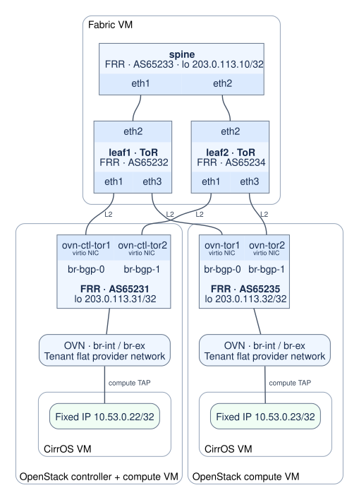

# OpenStack OVN BGP Service Plugin

Neutron 2026.2 の組み込み `ovn-bgp` service plugin と、2台の chassis の OVN Neutron Agent を使う。controller は Nova compute を兼ね、追加 compute はインスタンスを実行する。各 chassis の テナント VM は DevStack の `demo` プロジェクトが所有する非共有・内部の flat provider network に直接接続する。Neutron ルーターと Floating IP の作成は不要。`bgp-lr-main` はプラグインが OVN 内に作成する論理ルーター。 [Neutron 2026.2 の provider network 実装](https://github.com/openstack/neutron/blob/b82b437de7/neutron/services/bgp/commands.py#L271-L305)

## 実機検証結果（2026-11-23）

Ubuntu 26.04 の controller（`infra-lab-openstack`）と追加 compute（`infra-lab-openstack-compute`）、および fabric VM（`infra-lab-switches`、Containerlab 0.83.0 / FRR 10.4.1）で全検証を通過した。

- **DevStack・Nova・冪等性**: 両台で DevStack（Neutron `ovn-bgp`、Nova compute）を構築し、`discover_hosts.sh` により `infra-lab-openstack` と `infra-lab-openstack-compute` の両 `nova-compute` が `enabled / up` であることを確認した。両 chassis で `containerlab.sh configure` を2回連続実行し、2回目はいずれも Ansible の `changed=0 failed=0` を確認した。
- **実機知見と反映した修正**:
  - DevStack は OVS をソースビルドして `/usr/local/bin/ovs-vsctl` に配置し、実行時に OVS DB を初期化する。Netplan は `/usr/bin/ovs-vsctl` を参照するため、[chassis.yml](chassis.yml) に `/usr/bin/ovs-vsctl` へのシンボリックリンク作成と `br-ex` / `br-bgp-0` / `br-bgp-1` 不在時の `netplan apply` 発火を追加し、DevStack 実行後の再構成と2回目以降の冪等性を両立させた。
  - [terraform/main.tf](terraform/main.tf) の `openstack_compute_flavor_v2` は `is_public = true` を明示しないと `demo` プロジェクトから参照できなかったため追加した。
  - 仮想 L2 ブリッジ経由の ToR 片系断では chassis 側の BGP hold timer（9秒）満了まで戻り経路が残るため、[verify.sh](verify.sh) の `failover` 検証では経路収束後に疎通リトライ（`wait_for_traffic`）を行うようにした。
- **Terraform 適用・疎通・障害復旧・撤回**:
  - `terraform -chdir=terraform apply` で両 chassis 上のテナント VM（`ovn-bgp-vm`: `10.53.0.22`、`ovn-bgp-compute-vm`: `10.53.0.23`）がともに `ACTIVE` となり、2回目 `apply` で `No changes` を確認した。
  - 両 chassis の `sudo ./verify.sh chassis`（table 10 の IPv6 リンクローカル 2-way ECMP デフォルトと table 42 のローカル OVN `/32` 経路）、fabric VM の `sudo ./verify.sh advertised`、`sudo ./verify.sh reachable`（両 chassis と両テナント VM への spine からの ping 全損失 0%）、`sudo ./verify.sh failover`（`leaf1`・`leaf2` の片系断と復旧を通じた経路収束・疎通）がすべて終了コード 0 で通過した。
  - `terraform destroy -target='openstack_compute_instance_v2.guest["compute"]'` 後に fabric VM で `sudo ./verify.sh withdrawn 10.53.0.23` を確認し、再 `apply` 後に `sudo ./verify.sh advertised` での再広告も確認した。
- **共有ファブリック（`full-l3-ip-clos`）統合後の検証（2026-11-24）**:
  - 共有 2-Spine / 2-Leaf（`leaf1`/`leaf2` の `eth5`/`eth6`）＋ NAT へ統合した状態で、両 chassis の `verify.sh chassis`（IPv6 リンクローカル 2-way ECMP デフォルト・NAT IP 非流出・`1.1.1.1` 外向き ping 損失 0%）および fabric 側の `verify.sh advertised` / `reachable` / `failover` がすべて終了コード 0 で通過した。

## 検証ネットワーク



[図のソース](network-direct-tor.dot)

ToR と spine は fabric VM に置く。controller と追加 compute はそれぞれ両 ToR に独立した L2 セグメントで接続する。両 chassis で NIC 名は `ovn-tor1` と `ovn-tor2`、対応する OVS ブリッジ名は `br-bgp-0` と `br-bgp-1` に揃える。

| L2 セグメント | fabric VM の専用 NIC | ToR ポート | chassis の NIC |
| --- | --- | --- | --- |
| `infra-lab-ovn-ctl-tor1` | `ovn-ctl-tor1` | `leaf1:eth1` | controller `ovn-tor1` |
| `infra-lab-ovn-ctl-tor2` | `ovn-ctl-tor2` | `leaf2:eth1` | controller `ovn-tor2` |
| `infra-lab-ovn-tor1` | `ovn-tor1` | `leaf1:eth3` | compute `ovn-tor1` |
| `infra-lab-ovn-tor2` | `ovn-tor2` | `leaf2:eth3` | compute `ovn-tor2` |

コントローラー VM 内で compute のフレームを中継する案では、コントローラーの停止が compute の両 ToR リンクに波及する。fabric を物理ホスト上で動かす案は、物理ホストで FRR コンテナを実行する必要がある。採用構成は fabric VM 内にコンテナを隔離しながら、両 chassis の各リンクを独立させる。`containerlab.sh` は、fabric VM の専用 virtio NIC を対応する ToR のネットワーク名前空間に移す。表の ToR ポートはその virtio NIC 自体に対応する。

chassis FRR は OVS ブリッジのインターフェース名で両 ToR とピアを張る。ループバックは controller が `203.0.113.31/32`、compute が `203.0.113.32/32`。OVN がテーブル 42 に追加したローカル VM /32 を chassis が両 ToR に広告する。全6本の BGP ピアは eBGP Unnumbered。両 chassis は、IPv6 リンクローカル next hop の IPv4 デフォルト `0.0.0.0/0` を両 ToR から学習し、OVN が使用する `ovnvrf10` のテーブル 10 に入れる。spine の IPv4 プローブ /32 は ToR が学習し、chassis はデフォルトを使って到達する。`ovnvrf42` と `ovnvrf10` はプラグインが OVN と FRR の経路交換に使う。

両 chassis が使う [FRR テンプレート](frr/chassis.conf.j2) は、ホスト名・ASN・ループバック IP を [chassis.yml](chassis.yml) から受け取る。FRR は OVN の VRF 42 から再配布した IPv4 /32 と自ノードのループバックに BGP community `65233:42` を付与する。両 ToR はその community を持つ /32 を chassis 側ピアから受け付け、spine に広告する。全ノードで `frr defaults datacenter`・`remote-as external`・`timers 3 9`・`net.ipv4.fib_multipath_hash_policy=1` に統一し、各ノードの FRR 設定には自ノードのループバック IP 以外の IP やテナント CIDR を記述しない。本ラボの主眼は Dual-ToR と OVN BGP による VM /32 広告・撤回・ToR 片系断であり、spine 1 台でも spine→ToR の ECMP と ToR 片系断を検証できるため、構成をシンプルに保つ目的で spine は 1 台構成を採用している。

## ラボへの接続

管理端末から [共通手順](../common/README.md)で2台の管理 IP を確認する。管理 SSH は固定アドレスを使う。

```bash
ssh -J node3 ubuntu@CONTROLLER_IP
ssh -J node3 ubuntu@COMPUTE_IP
```

OpenStack CLI は controller VM 内で実行する。プロジェクトの VM を表示するには `demo`、compute サービスを確認するには `admin` を使う。

```bash
source "$HOME/devstack-ovn-bgp/openrc" demo demo
openstack server list
source "$HOME/devstack-ovn-bgp/openrc" admin admin
openstack compute service list --service nova-compute
```

## 構築

[共通セットアップ](../common/README.md)で Ubuntu 26.04 amd64 VM の `infra-lab-openstack` と `infra-lab-openstack-compute`、および fabric VM への4本のデータリンクを用意する。Docker と Containerlab の共通セットアップは fabric VM で実行する。テナント VM は cloud-init 対応イメージを使い、両 chassis の QEMU で起動する。VM 作成・起動はホストのメモリ条件を満たす必要がある。

controller で DevStack を起動する。既存 controller に compute だけを追加する場合は次の手順へ進む。

```bash
./setup-devstack.sh controller
```

compute の初回セットアップは DevStack の共有認証情報を標準入力で受け取る。認証情報の供給経路は環境のシークレット管理に従う。ログは compute の管理ユーザーだけが読めるようにする。

```bash
umask 077
./setup-devstack.sh compute CONTROLLER_IP < /path/to/provisioned/credential \
  > "$HOME/openstack-compute-setup.log" 2>&1
```

compute の DevStack が起動したら、controller で Nova のホストを検出し、両方のサービスが `up` であることを確認する。 [DevStack のマルチノード手順](https://docs.openstack.org/devstack/2026.2/guides/multinode-lab.html#configure-compute-nodes)

```bash
PATH="/opt/stack/data/venv/bin:$PATH" "$HOME/devstack-ovn-bgp/tools/discover_hosts.sh"
source "$HOME/devstack-ovn-bgp/openrc" admin admin
openstack compute service list --service nova-compute
```

controller 内で ToR を動かす旧構成から移行する場合は、旧チェックアウトの controller で `sudo ./containerlab.sh destroy` を実行する。その後、node3 で controller の旧 compute 中継用 NIC を取り外し、共通手順の新しい専用 NIC を取り付ける。

```bash
# fabric VM
sudo ./containerlab.sh deploy
# controller と compute のそれぞれ
sudo ./containerlab.sh configure
```

fabric VM の `deploy` は ToR と spine を起動し、専用 virtio NIC を ToR に割り当てる。各 chassis の `configure` はループバック、OVS、FRR、経路ポリシーを設定する。

直結構成から更新する場合は、fabric VM で稼働中のトポロジーを `sudo ./containerlab.sh destroy` で停止してから再度 `deploy` する。両 chassis で `configure` を再実行する。controller の旧 NIC 名はこの実行時に移行する。

## VM 固定 IP の検証

controller で Nova に両 compute ホストが登録済みであることを確認し、Glance に cloud-init 対応の `ubuntu-cloud` を用意する。Terraform の実行環境には、DevStack が生成する clouds.yaml を使用する。管理者プロジェクトは `devstack-admin`、demo プロジェクトは `devstack` で参照する。管理者が flavor・aggregate・demo 所有の flat network を管理し、demo がサブネット・セキュリティグループ・固定 IP ポート・VM を管理する。

```bash
openstack --os-cloud devstack-admin image list --name ubuntu-cloud
# イメージが未登録の場合のみ実行する。ファイルは配布元の SHA-256 を照合済みのものを使う。
openstack --os-cloud devstack-admin image create --public \
  --disk-format qcow2 --container-format bare \
  --file /path/to/ubuntu-24.04-server-cloudimg-amd64.img ubuntu-cloud
openstack --os-cloud devstack-admin compute service list --service nova-compute
terraform -chdir=terraform init
terraform -chdir=terraform apply
```

```bash
# controller
source "$HOME/devstack-ovn-bgp/openrc" admin admin
openstack network show ovn-bgp-direct -c project_id -c provider:network_type -c router:external -c shared
openstack server list --all-projects --long
openstack router list
openstack floating ip list
# fabric VM
sudo ./verify.sh advertised
sudo ./verify.sh reachable
sudo ./verify.sh failover
# controller と compute のそれぞれ
sudo ./verify.sh chassis
```

`advertised` は、テナント VM の `10.53.0.22/32` と `10.53.0.23/32` がそれぞれの chassis につながるインターフェース経由で両 ToR に入ることと、spine の ECMP を確認する。追加 compute では `chassis` がローカルの OVN 経路と両 ToR から学習したデフォルトを照合する。`failover` は ToR 側の chassis との接続を片系ずつ停止し、経路の収束と両 VM の固定 IP への ping を確認する。`advertised`、`reachable`、`failover`、`failover-routes` は `controller` または `compute` を引数に指定して片方だけを検証できる。`failover-routes` は収束と経路を確認する。

## flat provider network と DHCP

Neutron の `ovn-bgp` プラグインは、flat network の論理スイッチと論理ルーター `bgp-lr-main` を接続するポートのアドレス情報を OVN の `DHCP_Options` テーブルから取得する。サブネットの DHCP を有効にしてゲートウェイ（`10.53.0.1`）を設定することで、OVN は必要な DHCP オプションと論理ルーターポートを生成し、テナント VM 間の転送および spine からの到達性を確保する。ゲスト VM は OVN の分散 DHCP レスポンダーから自動的に IP とデフォルトルートを取得する。 [BGP プラグイン](https://github.com/openstack/neutron/blob/b82b437de7/neutron/services/bgp/commands.py#L85-L100) · [OVN DHCP の実装](https://github.com/openstack/neutron/blob/b82b437de7/neutron/plugins/ml2/drivers/ovn/mech_driver/ovsdb/ovn_client.py#L2983-L3013)

## 過去の確認結果

- 広告フィルターの更新時に、別 CIDR の一時 VM `10.54.0.22/32` が両 ToR と spine に伝わり、VM 削除後に撤回されることを確認した。

## 撤去

撤回試験では compute 側の VM を先に削除し、fabric で経路を確認してから残りを撤去する。同じ Terraform state を使用する。

```bash
terraform -chdir=terraform destroy -target='openstack_compute_instance_v2.guest["compute"]'
# fabric VM: sudo ./verify.sh withdrawn 10.53.0.23
terraform -chdir=terraform destroy
```

片方の VM を削除した後の撤回は fabric VM で `sudo ./verify.sh withdrawn 10.53.0.23` を実行して確認できる。VM の片付け後、両 chassis と fabric VM で `sudo ./containerlab.sh destroy` を実行する。DevStack 自体の切り戻しは共通手順に従う。
