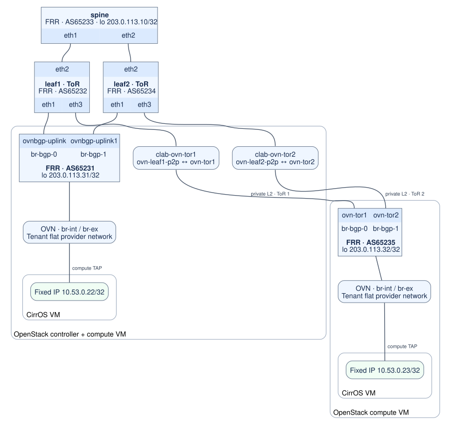

# OpenStack OVN BGP Service Plugin

Neutron 2026.2 の組み込み `ovn-bgp` service plugin と、2台の chassis の OVN Neutron Agent を使う。controller は Nova compute を兼ね、追加 compute はインスタンスを実行する。各 chassis の CirrOS VM は DevStack の `demo` プロジェクトが所有する非共有・内部の flat provider network に直接接続する。Neutron ルーターと Floating IP の作成は不要。図の `bgp-lr-main` はプラグインが OVN 内に作成する論理ルーター。 [Neutron 2026.2 の provider network 実装](https://github.com/openstack/neutron/blob/b82b437de7/neutron/services/bgp/commands.py#L271-L305)

## 検証ネットワーク



[図のソース](network.dot)

各 chassis は独立した2つの OVS ブリッジ `br-bgp-0` と `br-bgp-1` を使う。controller の `ovnbgp-uplink` と `ovnbgp-uplink1` は同じ VM 上の ToR コンテナに veth で接続する。追加 compute の `ovn-tor1` と `ovn-tor2` は、コントローラー上の専用 Linux ブリッジと2本のポイントツーポイント libvirt L2 セグメントで両 ToR に接続する。

chassis FRR は OVS ブリッジのインターフェース名で両 ToR とピアを張る。ループバックは controller が `203.0.113.31/32`、compute が `203.0.113.32/32`。OVN がテーブル 42 に追加したローカル VM /32 を chassis が両 ToR に広告する。全6本の BGP ピアは eBGP Unnumbered。両 chassis は IPv6 リンクローカル next hop の IPv6 デフォルト `::/0` を両 ToR から学習し、テーブル 10 に入れる。外部 IPv4 プローブへの戻りには、spine が広告する `203.0.113.10/32` を IPv6 next hop 付きで学習する。CirrOS のゲスト NIC は Neutron DHCP で構成される。

## ラボへの接続

管理端末から [共通手順](../common/README.md)で2台の管理 IP を確認する。管理 SSH は libvirt の DHCP アドレスを使う。

```bash
ssh -J node3 ubuntu@CONTROLLER_IP
ssh -J node3 ubuntu@COMPUTE_IP
```

OpenStack CLI は controller VM 内で実行する。プロジェクトの VM を表示するには `demo`、compute サービスを確認するには `admin` を使う。

```bash
source "$HOME/devstack-ovn-bgp/openrc" demo demo
openstack server list
source "$HOME/devstack-ovn-bgp/openrc" admin admin
openstack compute service list --service nova-compute
```

## 構築

[共通セットアップ](../common/README.md)で Ubuntu 26.04 amd64 VM の `infra-lab-openstack` と `infra-lab-openstack-compute`、および2本のデータリンクを用意する。Docker と Containerlab の共通セットアップは controller で実行する。CirrOS は両 chassis の QEMU で起動する。VM 作成・起動はホストのメモリ条件を満たす必要がある。

controller で DevStack を起動する。既存 controller に compute だけを追加する場合は次の手順へ進む。

```bash
./setup-devstack.sh controller
```

compute の初回セットアップは DevStack の共有認証情報を標準入力で受け取る。認証情報の供給経路は環境のシークレット管理に従う。ログは compute の管理ユーザーだけが読めるようにする。

```bash
umask 077
./setup-devstack.sh compute CONTROLLER_IP < /path/to/provisioned/credential \
  > "$HOME/openstack-compute-setup.log" 2>&1
```

compute の DevStack が起動したら、controller で Nova のホストを検出し、両方のサービスが `up` であることを確認する。 [DevStack のマルチノード手順](https://docs.openstack.org/devstack/2026.2/guides/multinode-lab.html#configure-compute-nodes)

```bash
PATH="/opt/stack/data/venv/bin:$PATH" "$HOME/devstack-ovn-bgp/tools/discover_hosts.sh"
source "$HOME/devstack-ovn-bgp/openrc" admin admin
openstack compute service list --service nova-compute
```

旧単一 chassis トポロジーから移行する場合は、旧チェックアウトの `sudo ./containerlab.sh destroy` で旧 ToR コンテナを停止してから切り替える。次をそれぞれの VM で実行する。

```bash
# controller
sudo ./containerlab.sh deploy
# compute
sudo ./containerlab.sh configure
```

controller の `deploy` は ToR と spine を起動し、ローカル chassis と compute のデータリンクを接続する。両 VM の `configure` はホスト側のループバック、OVS、FRR、経路ポリシーを再適用する。

## VM 固定 IP の検証

controller で管理者が `demo` 所有のネットワークと、検証 VM の配置先を指定する Nova availability zone を作る。テナント権限でサブネット、ポート、VM を作る。管理者が provider 属性を指定することで、ML2 の flat ドライバーを使う。既存環境を移行する場合は、同名のネットワーク・flavor・セキュリティグループと controller 側の既存 VM を再利用し、追加 compute 側の VM を作る。 [ML2 flat ドライバーの実装](https://github.com/openstack/neutron/blob/b82b437de7/neutron/plugins/ml2/drivers/type_flat.py#L112-L114)

```bash
source "$HOME/devstack-ovn-bgp/openrc" admin admin
openstack flavor create --vcpus 1 --ram 512 --disk 1 ovn-bgp-tiny
openstack aggregate create --zone ovn-bgp-controller ovn-bgp-controller
openstack aggregate add host ovn-bgp-controller infra-lab-openstack
openstack aggregate create --zone ovn-bgp-compute ovn-bgp-compute
openstack aggregate add host ovn-bgp-compute infra-lab-openstack-compute
openstack network create --project demo --internal --no-share \
  --provider-physical-network public --provider-network-type flat ovn-bgp-direct

source "$HOME/devstack-ovn-bgp/openrc" demo demo
openstack subnet create --network ovn-bgp-direct \
  --subnet-range 10.53.0.0/24 --gateway 10.53.0.1 ovn-bgp-direct-v4
openstack security group create ovn-bgp-icmp
openstack security group rule create --ingress --protocol icmp \
  --remote-ip 203.0.113.10/32 ovn-bgp-icmp

openstack port create --network ovn-bgp-direct \
  --fixed-ip subnet=ovn-bgp-direct-v4,ip-address=10.53.0.22 \
  --security-group ovn-bgp-icmp ovn-bgp-vm-port
openstack server create --wait --image cirros-0.6.3-x86_64-disk \
  --flavor ovn-bgp-tiny --port ovn-bgp-vm-port \
  --availability-zone ovn-bgp-controller ovn-bgp-vm
openstack port create --network ovn-bgp-direct \
  --fixed-ip subnet=ovn-bgp-direct-v4,ip-address=10.53.0.23 \
  --security-group ovn-bgp-icmp ovn-bgp-compute-vm-port
openstack server create --wait --image cirros-0.6.3-x86_64-disk \
  --flavor ovn-bgp-tiny --port ovn-bgp-compute-vm-port \
  --availability-zone ovn-bgp-compute ovn-bgp-compute-vm
```

```bash
# controller
source "$HOME/devstack-ovn-bgp/openrc" admin admin
openstack network show ovn-bgp-direct -c project_id -c provider:network_type -c router:external -c shared
openstack server list --all-projects --long
openstack router list
openstack floating ip list
sudo ./verify.sh advertised
sudo ./verify.sh reachable
sudo ./verify.sh failover
# compute
sudo ./verify.sh chassis
```

`advertised` は、テナント VM の `10.53.0.22/32` と `10.53.0.23/32` がそれぞれの chassis につながるインターフェース経由で両 ToR に入ることと、spine の ECMP を確認する。追加 compute では `chassis` がローカルの OVN 経路と両 ToR から学習したデフォルトを照合する。`failover` は ToR 側の chassis との接続を片系ずつ停止し、経路の収束と両 VM の固定 IP への ping を確認する。CirrOS の DHCP 設定は Nova の `ACTIVE` 表示より遅れる場合がある。

## 実機での確認状況

- controller は、テーブル 10 の IPv6 デフォルト `::/0` と IPv4 プローブ `203.0.113.10/32` を両 ToR から BGP で学習した。IPv6 デフォルトの next hop は両方ともリンクローカル。spine は既存 VM の `10.53.0.22/32` を両 ToR から学習した。
- spine から既存 VM への ICMP は chassis uplink まで到達した。IPv4 デフォルトを持たない構成では、`ovn-trace` が chassis の OVN 論理ルーターの `lr_in_ip_routing` で着信パケットのドロップを確認した。VM の TAP で ICMP は観測されなかった。
- 追加 compute VM は管理 SSH で接続でき、両 ToR のリンクローカルアドレスへの ping を確認した。compute の DevStack クラスターへの登録、追加 CirrOS VM の広告、2台を使う片系障害試験は未実施。

## 撤去

controller で `demo` の環境を読み込み、片方ずつ VM を削除して残る経路を確認する。ポートが残っていれば `openstack port delete` で削除してからネットワークを削除する。

```bash
source "$HOME/devstack-ovn-bgp/openrc" demo demo
openstack server delete --wait ovn-bgp-compute-vm
sudo ./verify.sh withdrawn 10.53.0.23
openstack server delete --wait ovn-bgp-vm
openstack network delete ovn-bgp-direct
openstack security group delete ovn-bgp-icmp

source "$HOME/devstack-ovn-bgp/openrc" admin admin
openstack aggregate remove host ovn-bgp-compute infra-lab-openstack-compute
openstack aggregate remove host ovn-bgp-controller infra-lab-openstack
openstack aggregate delete ovn-bgp-compute ovn-bgp-controller
openstack flavor delete ovn-bgp-tiny
```

compute、controller の順に `sudo ./containerlab.sh destroy` を実行する。DevStack 自体の切り戻しは共通手順に従う。
