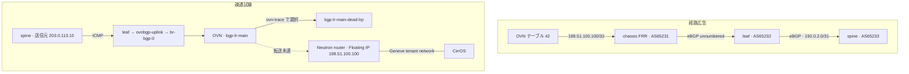

# OpenStack OVN BGP Service Plugin

Neutron 2026.2 の組み込み `ovn-bgp` service plugin と OVN Neutron Agent の `ovn-bgp` 拡張を有効にし、別のルーティングドメインから Floating IP への疎通と経路撤回を確認する。OVN が Linux VRF のテーブル 42 に置いた経路を chassis の FRR が取得し、leaf、spine の順に eBGP で伝える。leaf から受信するデフォルト経路はテーブル 10 に入れ、OVN の戻り経路に使う。

## 論理構成



## 構築

node3 上のこのラボ専用 Ubuntu 26.04 amd64 VM で実行する。DevStack は VM のパッケージ、サービス、ファイアウォールを変更するため、セットアップ前の状態を残したい場合は VM のスナップショットを取得する。node3 の割り当ては 8 vCPU、16 GiB メモリ、120 GiB ディスク。CirrOS は QEMU で起動するため、ネストされた KVM は不要。パッケージ、Git リポジトリ、CirrOS イメージ、コンテナイメージへのアクセスが必要。

[共通手順](../common/README.md)で Docker と containerlab を用意する。以下は専用 VM の sudo が使える管理ユーザーで実行する。DevStack は非 root の sudo パスワード不要ユーザーで実行する。

```bash
./setup-devstack.sh
```

スクリプトは専用パスワードを生成し、DevStack の `local.conf` にアクセス権 0600 で保存する。

DevStack が成功したら、このディレクトリに戻って実行する。

```bash
sudo containerlab deploy -t topology.clab.yml
sudo ovs-vsctl --may-exist add-br br-ex
sudo ovs-vsctl --may-exist add-br br-bgp-0
sudo ovs-vsctl --may-exist add-port br-bgp-0 ovnbgp-uplink
sudo ip link set br-bgp-0 up
sudo ip link set br-ex up
sudo ovs-vsctl set Open_vSwitch . external_ids:ovn-bridge-mappings=public:br-ex,br-bgp-0:br-bgp-0

sudo sed -i 's/^bgpd=no$/bgpd=yes/' /etc/frr/daemons
sudo install -o frr -g frr -m 640 frr/chassis.conf /etc/frr/frr.conf
sudo systemctl restart frr
```

## Floating IP の検証

専用 VM で DevStack の `openrc` を読み込む。以下のコマンドは空のラボにリソースを作成する。

```bash
source "$HOME/devstack-ovn-bgp/openrc" admin admin
openstack network agent list
openstack extension list --network | grep ovn-bgp

openstack network create --external --provider-physical-network public \
  --provider-network-type flat ovn-bgp-public
openstack subnet create --network ovn-bgp-public \
  --subnet-range 198.51.100.0/24 --gateway 198.51.100.1 \
  --allocation-pool start=198.51.100.50,end=198.51.100.150 --no-dhcp ovn-bgp-public-v4

openstack network create ovn-bgp-tenant
openstack subnet create --network ovn-bgp-tenant \
  --subnet-range 10.53.0.0/24 ovn-bgp-tenant-v4
openstack router create ovn-bgp-router
openstack router add subnet ovn-bgp-router ovn-bgp-tenant-v4
openstack router set --external-gateway ovn-bgp-public ovn-bgp-router

openstack security group create ovn-bgp-icmp
openstack security group rule create --ingress --protocol icmp \
  --remote-ip 203.0.113.10/32 ovn-bgp-icmp
openstack flavor create --vcpus 1 --ram 512 --disk 1 ovn-bgp-tiny
openstack server create --wait --image cirros-0.6.3-x86_64-disk \
  --flavor ovn-bgp-tiny --network ovn-bgp-tenant \
  --security-group ovn-bgp-icmp ovn-bgp-vm

openstack floating ip create --floating-ip-address 198.51.100.100 ovn-bgp-public
openstack server add floating ip ovn-bgp-vm 198.51.100.100
```

VM が起動したら、OVN、BGP、疎通を順に確認する。

```bash
sudo ovn-nbctl lr-list
sudo ovn-sbctl list Advertised_Route
sudo ip route show table 42
sudo ip route show table 10
sudo ovs-ofctl dump-flows br-bgp-0
sudo ./verify.sh advertised
sudo ./verify.sh reachable
```

`bgp-lr-main` と chassis 用 logical router が存在し、テーブル 42 と spine に `198.51.100.100/32` が現れる。`advertised` はテーブル 42、spine の BGP RIB と Linux FIB を照合する。テーブル 10 では leaf からのデフォルト経路を確認できる。`reachable` は spine のループバックを送信元にした ping が CirrOS まで往復すれば合格。

node3 の単一 chassis 構成では、FIP の BGP 広告・撤回・再広告を確認済み。実パケットは `ovnbgp-uplink` に到着したが、CirrOS の TAP には届かなかった。`ovn-trace` では `bgp-lr-main` が FIP 宛てに `bgp-lr-main-dead-lrp` を選んだ。疎通試験はこの転送上の問題を再現する。

Floating IP を削除し、leaf の両 BGP セッションが Established の状態で spine から該当経路が消えることを確認する。

```bash
openstack floating ip delete 198.51.100.100
sudo ./verify.sh withdrawn
```

## 片付けと切り戻し

OpenStack を保持する場合は、専用 VM 内で次の順でリソースを片付ける。Floating IP が残っている場合は先に削除する。

```bash
openstack server delete --wait ovn-bgp-vm
openstack router unset --external-gateway ovn-bgp-router
openstack router remove subnet ovn-bgp-router ovn-bgp-tenant-v4
openstack router delete ovn-bgp-router
openstack network delete ovn-bgp-tenant
openstack network delete ovn-bgp-public
openstack security group delete ovn-bgp-icmp
openstack flavor delete ovn-bgp-tiny

sudo ovs-vsctl --if-exists del-port br-bgp-0 ovnbgp-uplink
sudo ovs-vsctl --if-exists del-br br-bgp-0
sudo containerlab destroy -t topology.clab.yml --cleanup
```

DevStack や chassis FRR の導入を含めて切り戻す場合は、専用 VM を構築前のスナップショットに戻すか、共通手順で専用 VM を作り直す。再実行前に VM 内の管理アドレスとルートを確認する。

- [Neutron 2026.2 の OVN BGP service plugin](https://docs.openstack.org/neutron/2026.2/admin/ovn/bgp.html)
- [Neutron 2026.2 の BGP 統合テスト](https://docs.openstack.org/neutron/2026.2/ovn/bgp_tempest_job.html)
- [統合テストのバージョン固定と DevStack 設定](https://github.com/openstack/neutron/blob/stable/2026.2/zuul.d/tempest-multinode-bgp.yaml)
